# Lab 6 — Test Runner, báo cáo, logging & chạy song song

Làm tiếp trên framework của Bài 5. Test chạy bằng **Test Explorer** của Visual Studio 2026. Các lệnh `dotnet test` đề bài yêu cầu được gõ trong cửa sổ **Terminal của Visual Studio** (View > Terminal). Ảnh chụp nằm trong `screenshots/`, tên bắt đầu bằng `lab6_`.

Những gì thêm mới:

```
FirstTests/
├── Core/
│   ├── BaseTest.cs           + ghi log BẮT ĐẦU ở [SetUp], OK/RỚT ở [TearDown]
│   └── ParallelSettings.cs   [assembly: Parallelizable(Fixtures)] + LevelOfParallelism(6)
├── Pages/CheckoutPage.cs     trang Checkout: Your Information (dùng cho Phần E)
├── Tests/CheckoutTests.cs    8 ca ô Postal Code đã lọc từ đề xuất của AI
├── Tests/NhatKyMauTests.cs   [Explicit] 1 ca đậu + 1 ca cố ý rớt để xem nhật ký (Phần B)
└── Utilities/Log.cs          Info / Warn / Error, có thời gian + mức độ + mã luồng
dotnet-tools.json             công cụ trxlog2html (cài cục bộ cho repo)
docs/lab6_nhatky_mau.log      đoạn nhật ký thật (Phần B)
docs/lab6_ketqua.html         báo cáo HTML sinh từ ketqua.trx (Phần C)
```

## Phần A — Tổ chức test với `[Category]`

| Category | Gắn ở đâu | Số ca |
|---|---|---|
| `Smoke` | đăng nhập đúng, danh sách 6 sản phẩm, sắp xếp giá, mở trang chủ Selenium, Postal Code hợp lệ | 5 |
| `Login` | cả class `LoginTests` (gồm 9 ca data-driven) | 13 |
| `Checkout` | cả class `CheckoutTests` | 8 |
| `TheInternet` | `AlertIframeTests`, `DynamicLoadingTests` | 6 |
| `Slow` | `DynamicLoadingTests` (chờ ~10 giây) và ca iframe | 2 chạy thường |
| `NhatKyMau` | `NhatKyMauTests` (Explicit, chỉ chạy khi gọi đúng tên nhóm) | 2 |

Chạy chọn lọc bằng 2 cách, kết quả giống nhau:

| Điều kiện | Test Explorer (ô Search) | Terminal của VS | Kết quả |
|---|---|---|---|
| Chỉ Smoke | `Trait:"Smoke"` | `dotnet test FirstTests --filter "Category=Smoke"` | 5 ca, 5 Passed |
| Bỏ Slow | `-Trait:"Slow"` | `dotnet test FirstTests --filter "Category!=Slow"` | 26 ca, 26 Passed |

| `--filter "Category=Smoke"` | `--filter "Category!=Slow"` |
|---|---|
| 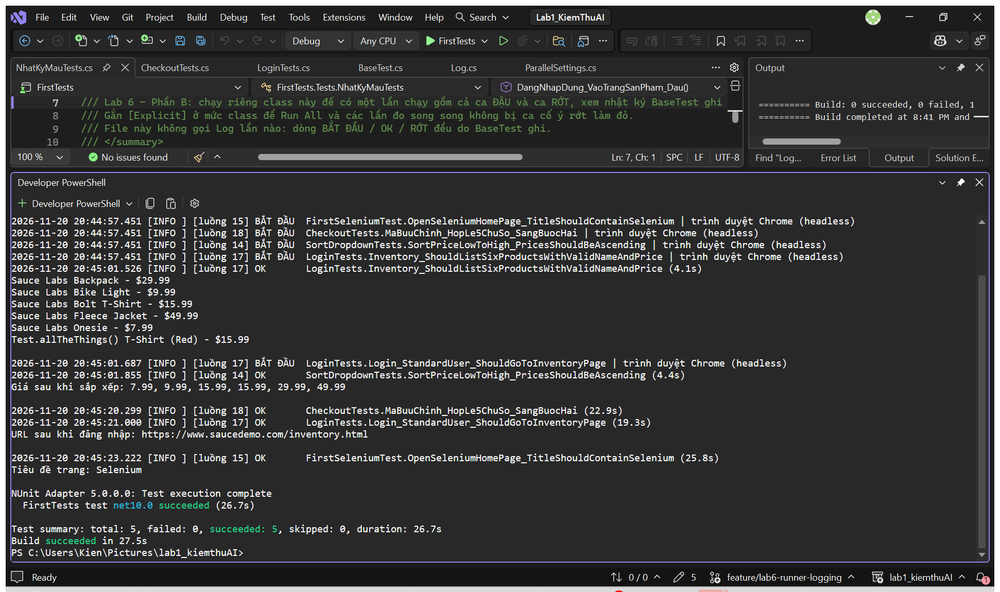 |  |

## Phần B — Logging vào BaseTest

`Utilities/Log.cs` có `Info`, `Warn`, `Error`. Mỗi dòng có thời gian tới mili giây, mức độ và mã luồng (để nhìn ra ca nào chạy trên luồng nào khi bật song song). Dòng log được in qua `TestContext.Progress.WriteLine`, nên thấy ngay trên terminal mà không cần cờ `verbosity=detailed`. Đồng thời log được ghi vào file `bin/Debug/net10.0/Logs/nhatky_yyyyMMdd.log`, mỗi lần chạy mở đầu bằng một dòng `=====`.

`BaseTest` ghi `BẮT ĐẦU` ở `[SetUp]` và `OK` hoặc `RỚT` (mức `ERROR`, kèm dòng đầu của thông báo lỗi) ở `[TearDown]`. File test không gọi `Log` lần nào: tìm `Log\.(Info|Warn|Error)` trong `FirstTests\Tests` bằng Find in Files ra 0 kết quả trên 9 file.

Để có một lần chạy gồm cả ca đậu và ca rớt, nhóm thêm `Tests/NhatKyMauTests.cs`, gắn `[Explicit]` ở mức class. Class này có 1 ca đăng nhập đúng và 1 ca cố ý kỳ vọng sai (tài khoản bị khóa mà kỳ vọng vào được). Gắn `[Explicit]` để Run All và các lần đo song song không bị ca này làm đỏ. Muốn chạy thì lọc `Trait:"NhatKyMau"` trong Test Explorer, hoặc chạy `dotnet test --filter "Category=NhatKyMau"`. File này cũng không gọi `Log`, mọi dòng nhật ký đều do `BaseTest` ghi. Nhật ký thật của lần chạy từ Test Explorer (`docs/lab6_nhatky_mau.log`):

```
===== Lần chạy lúc 19:56:15 =====
2026-11-20 19:56:15.240 [INFO ] [luồng 18] BẮT ĐẦU  NhatKyMauTests.DangNhapDung_VaoTrangSanPham_Dau | trình duyệt Chrome (headless)
2026-11-20 19:56:16.742 [INFO ] [luồng 18] OK       NhatKyMauTests.DangNhapDung_VaoTrangSanPham_Dau (1.6s)
2026-11-20 19:56:16.893 [INFO ] [luồng 18] BẮT ĐẦU  NhatKyMauTests.TaiKhoanBiKhoa_CoYKyVongVaoDuoc_Rot | trình duyệt Chrome (headless)
2026-11-20 19:56:21.684 [ERROR] [luồng 18] RỚT     NhatKyMauTests.TaiKhoanBiKhoa_CoYKyVongVaoDuoc_Rot (4.8s) | Cố ý sai để có dòng [ERROR] trong nhật ký
2026-11-20 19:56:21.756 [INFO ] [luồng 18] Đã chụp ảnh khi test rớt: FirstTests\bin\Debug\net10.0\FailureScreenshots\TaiKhoanBiKhoa_CoYKyVongVaoDuoc_Rot.png
```

| Test Explorer: 1 Passed, 1 Failed | Cùng lần chạy trong Terminal của VS |
|---|---|
| 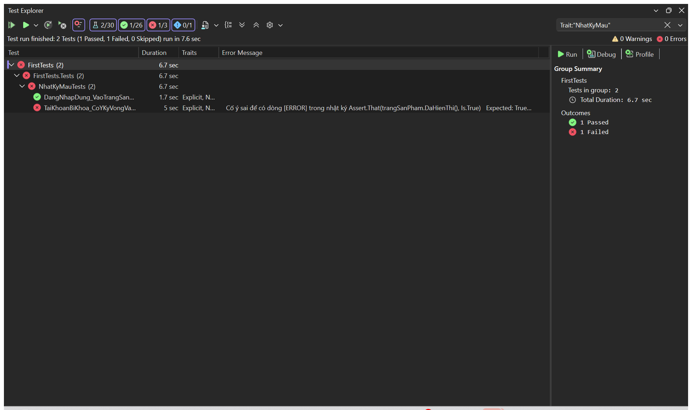 | 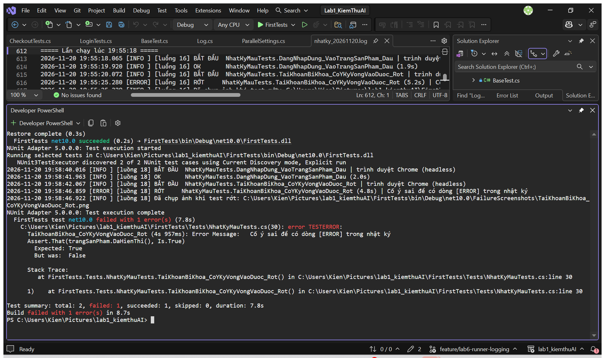 |

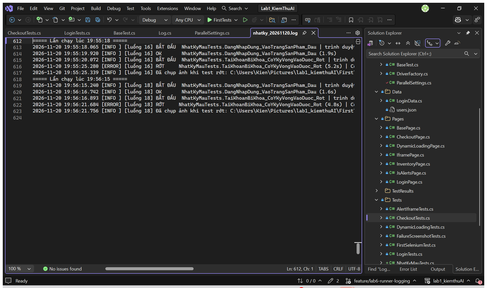

## Phần C — Báo cáo HTML

Chạy trong Terminal của VS:

```
dotnet test FirstTests --logger "trx;LogFileName=ketqua.trx"
dotnet trxlog2html -i FirstTests\TestResults\ketqua.trx -o FirstTests\TestResults\ketqua.html
```

`trxlog2html` được cài dạng local tool (`dotnet tool install trxlog2html`, ghi vào `dotnet-tools.json`), người khác clone repo về chỉ cần `dotnet tool restore`. Công cụ này build cho .NET 9 mà máy chỉ có .NET 8 và 10, nên trong manifest phải bật `"rollForward": true` thì mới chạy được.

Báo cáo cho thấy **9 class, 32 ca: 28 passed, 0 failed**. Còn 4 ca là các ca `[Explicit]` (2 ca cố ý rớt của Bài 3 và 2 ca `NhatKyMau`), không chạy khi chạy cả bộ. Trang HTML được mở trong Edge để chụp, vì Visual Studio không hiển thị được trang HTML. Bản HTML được chép vào `docs/lab6_ketqua.html` vì thư mục `TestResults/` bị `.gitignore` bỏ qua.

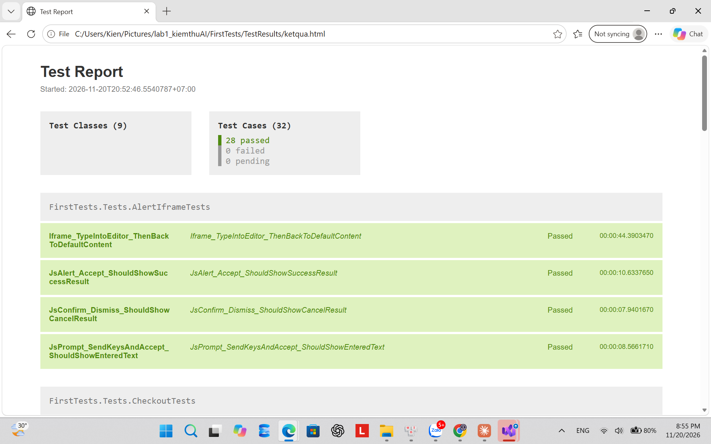

## Phần D — Chạy song song & thread-safety

```csharp
[assembly: Parallelizable(ParallelScope.Fixtures)]
[assembly: LevelOfParallelism(6)]   // bằng số nhân CPU: AMD Ryzen 5 220, 6 nhân / 12 luồng
```

Mọi lần đo đều bật `"Headless": true`.

**Đo bằng `dotnet test` trong Terminal của VS, cùng một bản build.** Thêm `-- NUnit.NumberOfTestWorkers=0` để NUnit tắt chạy song song mà không phải sửa code:

| | Lệnh | Kết quả | Thời gian |
|---|---|---|---|
| Tuần tự | `dotnet test FirstTests -- NUnit.NumberOfTestWorkers=0` | 28 succeeded, 0 failed | **108,6 giây** |
| Song song | `dotnet test FirstTests` | 28 succeeded, 0 failed | **75,2 giây** |

| Tuần tự | Song song |
|---|---|
| 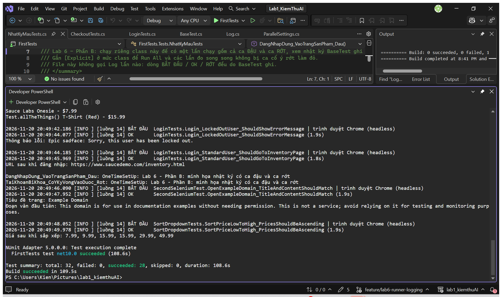 | 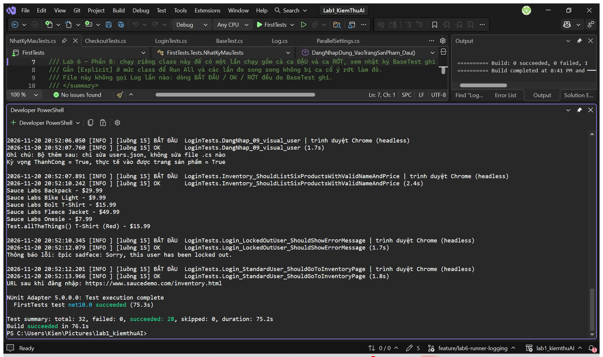 |

Khi tuần tự, mọi dòng nhật ký đều cùng một mã luồng. Khi song song thì có nhiều mã luồng xen kẽ, tức là các class chạy cùng lúc.

**Chạy song song 3 lần liên tiếp bằng Run All trong Test Explorer:** 1,4 phút, 1,3 phút, 1,5 phút, cả 3 lần đều 28/28 Passed. Kết quả không đổi so với tuần tự, không ca nào rớt thêm. Thời gian trong Test Explorer dao động giữa các lần chạy (1,3–1,5 phút; có lần đo trước đó chỉ 54 giây) vì 6 Chrome chạy cùng lúc nên tốc độ phụ thuộc nhiều vào máy có đang bận việc khác hay không. Vì vậy số liệu để so sánh tuần tự/song song nhóm lấy từ hai lệnh dotnet test chạy liền nhau ở trên. Song song không nhanh hơn được nữa vì `LoginTests` có 13 ca chạy lần lượt trong một fixture, mất khoảng 50 giây; đó là phần dài nhất, không chia nhỏ được nếu chỉ song song theo fixture.

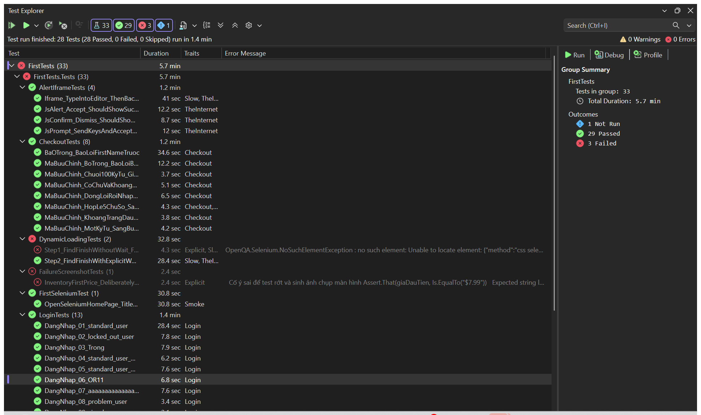

### Quá trình: một lần rớt ngẫu nhiên và cách sửa

Lúc đầu nhóm để `LevelOfParallelism(4)`, tuần tự 1,7 phút còn song song 1,2–1,4 phút. Lần chạy song song thứ 3 lúc đó có 1 ca rớt: `DangNhap_04` báo `System.IO.IOException: The process cannot access the file ...nhatky_20261120.log because it is being used by another process`. Nguyên nhân là nhóm đang mở file nhật ký trong editor của Visual Studio, VS đọc lại file đúng lúc test ghi log trong `[SetUp]`. Đây không phải hai luồng test tranh nhau: trong tiến trình test, việc ghi file đã nằm trong `lock`. Có điều chạy song song làm số lần ghi dày hơn nên dễ trúng lúc VS đang đọc. Lỗi này kéo theo lỗi thứ hai: `[TearDown]` cố chụp ảnh bằng `driver` của ca trước đã Dispose (`Cannot access a disposed object`).

Cách sửa (commit `fix: ghi log không làm test rớt...`):
- `Log.GhiFile` thử ghi lại tối đa 5 lần, vẫn không được thì bỏ dòng đó trong file. Ghi log hỏng không được phép làm test rớt.
- `BaseTest` gán `driver = null` sau khi đóng trình duyệt.

Sau khi sửa, nhóm vẫn để file log mở trong VS và chạy song song 3 lần, cả 3 lần đều xanh. Sau đó nhóm nâng lên `LevelOfParallelism(6)` theo gợi ý của đề (bằng số nhân CPU) và đo lại như ở trên.

| Lần rớt ngẫu nhiên (trước khi sửa) | Chi tiết lỗi |
|---|---|
| 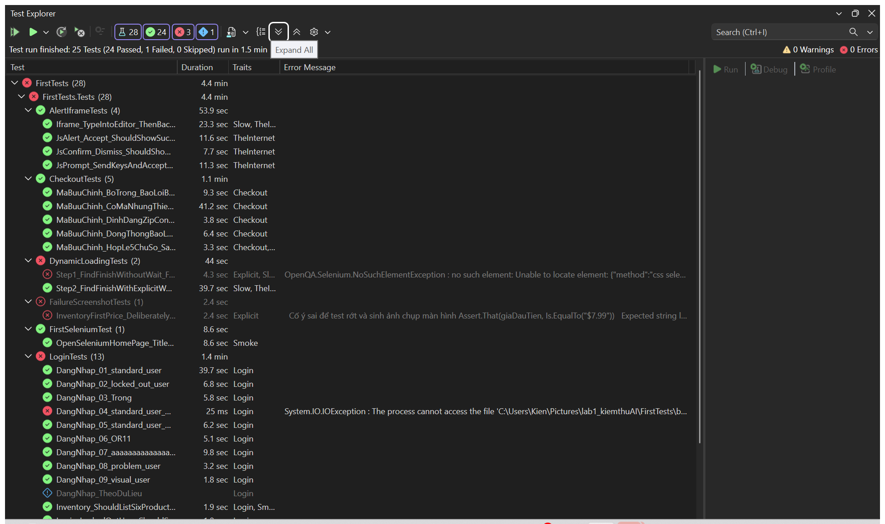 | 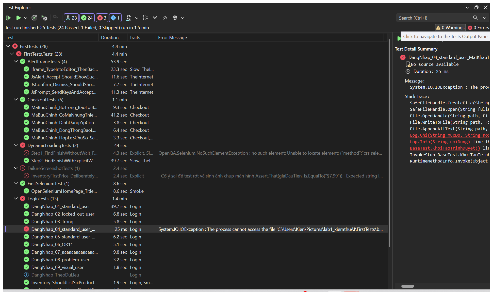 |

### Vì sao framework này thread-safe?

`driver`, `cfg` và đồng hồ đo thời gian trong `BaseTest` đều là **field thường của từng đối tượng test**, không phải `static`. Với `ParallelScope.Fixtures`, mỗi class test chạy trên một luồng riêng và có Chrome riêng, các ca trong cùng class vẫn chạy lần lượt nên không ca nào dùng chung trình duyệt với ca khác. Những thứ `static` còn lại thì hoặc chỉ đọc (`ConfigReader` dùng `Lazy<T>`, mặc định an toàn khi nhiều luồng gọi cùng lúc; `users.json` chỉ đọc), hoặc được khóa (`Log` ghi file trong `lock`). Ảnh chụp lỗi lấy tên theo từng ca nên không ghi đè lên nhau.

Nhóm không nâng lên `ParallelScope.Children`: NUnit chỉ tạo **một** đối tượng cho mỗi fixture, nếu các ca trong `LoginTests` chạy song song thì chúng sẽ dùng chung một field `driver`. Muốn làm vậy phải thêm `[FixtureLifeCycle(LifeCycle.InstancePerTestCase)]`.

## Phần E — AI sinh & thẩm định

Ô được chọn: **Zip/Postal Code** ở trang Checkout: Your Information của saucedemo (đăng nhập rồi vào `checkout-step-one.html`). Nhóm viết `Pages/CheckoutPage.cs` trước để AI có sẵn hàm mà gọi.

**AI được dùng:** một phiên Claude mới, không có ngữ cảnh của bài, không đọc được code của repo và không dùng công cụ nào (không lên mạng, không chạy thử); nó chỉ nhận đúng prompt bên dưới. Lúc đầu nhóm hỏi ngay trong phiên trợ lý đang giúp làm bài, nhưng phiên đó đã biết trước saucedemo hoạt động ra sao, nên kết quả không khách quan. Nhóm bỏ kết quả đó và hỏi lại bằng phiên mới.

### Prompt đã dùng

> Mình đang viết test Selenium C# (NUnit 4, .NET 10) cho ô **Zip/Postal Code** ở trang Checkout: Your Information của https://www.saucedemo.com (sau khi đăng nhập standard_user / secret_sauce, trang checkout-step-one.html có 3 ô First Name, Last Name, Zip/Postal Code và nút Continue).
>
> Framework đã có sẵn:
> - Lớp `BaseTest` lo mở trình duyệt, đăng nhập thì gọi `new LoginPage(driver).DangNhap("standard_user", "secret_sauce")`.
> - Page Object `CheckoutPage` với các hàm: `Mo()`, `DienThongTin(ho, ten, maBuuChinh)`, `BamTiepTuc()`, `DaSangBuocHai()` (bool), `CoThongBaoLoi()` (bool), `LayThongBaoLoi()` (string), `DongThongBaoLoi()`, `LayMaBuuChinhDangNhap()` (string).
>
> Hãy liệt kê các ca kiểm thử cho ô Zip/Postal Code, có cả ca biên, và viết luôn code NUnit (class kế thừa BaseTest, mỗi ca có câu Assert rõ ràng). Trả về toàn bộ code của file test.

### Kết quả AI trả về (nguyên văn)

**Các ca kiểm thử cho ô Zip/Postal Code**

Trang này chỉ chặn trường hợp ô trống. Khi ô trống, nó báo "Error: Postal Code is required". Ngoài ra trang không giới hạn độ dài và không kiểm tra định dạng.

| # | Ca kiểm thử | Dữ liệu Postal Code | Kết quả mong đợi |
|---|---|---|---|
| TC01 | Hợp lệ, 5 chữ số | `70000` | Sang bước 2 |
| TC02 | Bỏ trống (ca biên: độ dài 0) | `""` | Báo lỗi "Error: Postal Code is required", vẫn ở bước 1 |
| TC03 | Ca biên dưới: 1 ký tự | `1` | Sang bước 2 |
| TC04 | Ca biên trên: chuỗi dài 100 ký tự | `"9" x 100` | Ô giữ đủ 100 ký tự, sang bước 2 |
| TC05 | Có chữ và khoảng trắng (mã kiểu Anh) | `SW1A 1AA` | Sang bước 2 |
| TC06 | Chỉ có khoảng trắng | `"   "` | Trang hiện tại vẫn cho sang bước 2 vì không cắt khoảng trắng. Đây là chỗ nên ghi nhận là lỗi tiềm ẩn |
| TC07 | Ký tự đặc biệt hoặc chuỗi giống script | `<script>alert(1)</script>` | Ô giữ nguyên chuỗi, không bật hộp thoại alert, sang bước 2 |
| TC08 | Có khoảng trắng ở đầu và cuối | `"  70000  "` | Sang bước 2 |
| TC09 | Thứ tự báo lỗi: cả 3 ô đều trống | `""` | Báo lỗi First Name trước, chưa báo lỗi Postal Code |
| TC10 | Đóng thông báo lỗi rồi nhập lại | `""` rồi `70000` | Đóng được thông báo lỗi, nhập lại mã hợp lệ thì sang bước 2 |

Hai giả định trong code. Thứ nhất, `BaseTest` cho lớp con dùng biến `driver`. Thứ hai, `CheckoutPage` nhận `driver` qua hàm khởi tạo. Nếu một trong hai khác trong project của bạn thì sửa lại cho khớp. `[SetUp]` của lớp con chạy sau `[SetUp]` của `BaseTest`, nên lúc đăng nhập trình duyệt đã được mở sẵn.

<details>
<summary>AiPostalCodeTests.cs — 10 ca (bấm để mở)</summary>

```csharp
using FirstTests.Core;
using FirstTests.Pages;
using NUnit.Framework;
using OpenQA.Selenium;

namespace FirstTests.Tests
{
    [TestFixture]
    [Category("PostalCode")]
    public class AiPostalCodeTests : BaseTest
    {
        private const string Ho = "Nguyen";
        private const string Ten = "An";
        private const string LoiThieuMaBuuChinh = "Error: Postal Code is required";
        private const string LoiThieuHo = "Error: First Name is required";

        private CheckoutPage checkout = null!;

        [SetUp]
        public void MoTrangCheckout()
        {
            new LoginPage(driver).DangNhap("standard_user", "secret_sauce");
            checkout = new CheckoutPage(driver);
            checkout.Mo();
        }

        [Test]
        [Description("TC01 - Mã bưu chính hợp lệ 5 chữ số thì sang bước 2")]
        public void TC01_MaHopLe5ChuSo_SangBuocHai()
        {
            checkout.DienThongTin(Ho, Ten, "70000");
            checkout.BamTiepTuc();

            Assert.That(checkout.DaSangBuocHai(), Is.True,
                "Nhập mã bưu chính hợp lệ nhưng không sang được bước 2.");
        }

        [Test]
        [Description("TC02 - Bỏ trống mã bưu chính thì báo lỗi bắt buộc")]
        public void TC02_BoTrong_BaoLoiBatBuoc()
        {
            checkout.DienThongTin(Ho, Ten, "");
            checkout.BamTiepTuc();

            Assert.Multiple(() =>
            {
                Assert.That(checkout.DaSangBuocHai(), Is.False,
                    "Bỏ trống mã bưu chính mà vẫn sang bước 2.");
                Assert.That(checkout.CoThongBaoLoi(), Is.True,
                    "Không thấy thông báo lỗi.");
                Assert.That(checkout.LayThongBaoLoi(), Is.EqualTo(LoiThieuMaBuuChinh),
                    "Nội dung thông báo lỗi không đúng.");
            });
        }

        [Test]
        [Description("TC03 - Ca biên dưới: 1 ký tự")]
        public void TC03_BienDuoi_MotKyTu_SangBuocHai()
        {
            checkout.DienThongTin(Ho, Ten, "1");
            checkout.BamTiepTuc();

            Assert.That(checkout.DaSangBuocHai(), Is.True,
                "Mã bưu chính 1 ký tự bị từ chối.");
        }

        [Test]
        [Description("TC04 - Ca biên trên: chuỗi rất dài 100 ký tự")]
        public void TC04_BienTren_ChuoiDai_GiuNguyenVaSangBuocHai()
        {
            string maDai = new string('9', 100);

            checkout.DienThongTin(Ho, Ten, maDai);

            Assert.That(checkout.LayMaBuuChinhDangNhap(), Is.EqualTo(maDai),
                "Ô Postal Code đã cắt bớt chuỗi dài.");

            checkout.BamTiepTuc();

            Assert.That(checkout.DaSangBuocHai(), Is.True,
                "Mã bưu chính 100 ký tự không sang được bước 2.");
        }

        [Test]
        [Description("TC05 - Mã có chữ và khoảng trắng (kiểu Anh)")]
        public void TC05_MaCoChuVaKhoangTrang_SangBuocHai()
        {
            checkout.DienThongTin(Ho, Ten, "SW1A 1AA");
            checkout.BamTiepTuc();

            Assert.That(checkout.DaSangBuocHai(), Is.True,
                "Mã bưu chính dạng chữ và số bị từ chối.");
        }

        [Test]
        [Description("TC06 - Chỉ nhập khoảng trắng: trang hiện tại vẫn cho qua (lỗi tiềm ẩn)")]
        public void TC06_ChiKhoangTrang_HanhViHienTai_VanSangBuocHai()
        {
            checkout.DienThongTin(Ho, Ten, "   ");
            checkout.BamTiepTuc();

            // Ghi nhận hành vi thực tế: trang không trim nên vẫn cho qua.
            // Nếu yêu cầu nghiệp vụ là phải chặn thì đây là lỗi cần báo.
            Assert.That(checkout.DaSangBuocHai(), Is.True,
                "Hành vi đã thay đổi: chuỗi toàn khoảng trắng giờ bị chặn.");
        }

        [Test]
        [Description("TC07 - Ký tự đặc biệt hoặc chuỗi script không bị thực thi")]
        public void TC07_KyTuDacBiet_KhongThucThiScript()
        {
            const string chuoiScript = "<script>alert(1)</script>";

            checkout.DienThongTin(Ho, Ten, chuoiScript);

            Assert.That(checkout.LayMaBuuChinhDangNhap(), Is.EqualTo(chuoiScript),
                "Ô Postal Code không giữ nguyên chuỗi ký tự đặc biệt.");

            checkout.BamTiepTuc();

            Assert.Multiple(() =>
            {
                Assert.That(CoHopThoaiAlert(), Is.False,
                    "Chuỗi script đã bị thực thi và bật hộp thoại alert.");
                Assert.That(checkout.DaSangBuocHai(), Is.True,
                    "Chuỗi ký tự đặc biệt không sang được bước 2.");
            });
        }

        [Test]
        [Description("TC08 - Có khoảng trắng ở đầu và cuối")]
        public void TC08_KhoangTrangDauCuoi_SangBuocHai()
        {
            checkout.DienThongTin(Ho, Ten, "  70000  ");
            checkout.BamTiepTuc();

            Assert.That(checkout.DaSangBuocHai(), Is.True,
                "Mã bưu chính có khoảng trắng ở đầu và cuối bị từ chối.");
        }

        [Test]
        [Description("TC09 - Cả 3 ô trống thì báo lỗi First Name trước")]
        public void TC09_CaBaOTrong_BaoLoiFirstNameTruoc()
        {
            checkout.DienThongTin("", "", "");
            checkout.BamTiepTuc();

            Assert.Multiple(() =>
            {
                Assert.That(checkout.DaSangBuocHai(), Is.False);
                Assert.That(checkout.LayThongBaoLoi(), Is.EqualTo(LoiThieuHo),
                    "Thứ tự kiểm tra không đúng: phải báo First Name trước.");
                Assert.That(checkout.LayThongBaoLoi(), Is.Not.EqualTo(LoiThieuMaBuuChinh));
            });
        }

        [Test]
        [Description("TC10 - Đóng thông báo lỗi rồi nhập lại mã hợp lệ")]
        public void TC10_DongLoiRoiNhapLai_SangBuocHai()
        {
            checkout.DienThongTin(Ho, Ten, "");
            checkout.BamTiepTuc();
            Assert.That(checkout.CoThongBaoLoi(), Is.True, "Chưa thấy thông báo lỗi ban đầu.");

            checkout.DongThongBaoLoi();
            Assert.That(checkout.CoThongBaoLoi(), Is.False, "Bấm đóng nhưng thông báo lỗi vẫn còn.");

            checkout.DienThongTin(Ho, Ten, "70000");
            checkout.BamTiepTuc();

            Assert.That(checkout.DaSangBuocHai(), Is.True,
                "Đã nhập lại mã hợp lệ nhưng không sang được bước 2.");
        }

        private bool CoHopThoaiAlert()
        {
            try
            {
                driver.SwitchTo().Alert().Dismiss();
                return true;
            }
            catch (NoAlertPresentException)
            {
                return false;
            }
        }
    }
}
```

</details>

### Chạy thử trên Visual Studio

Nhóm dán nguyên file AI vào `Tests/`, Rebuild, lọc `Class:"AiPostalCodeTests"` trong Test Explorer rồi Run: **10/10 Passed**. Chạy xong nhóm xóa file này, không commit.

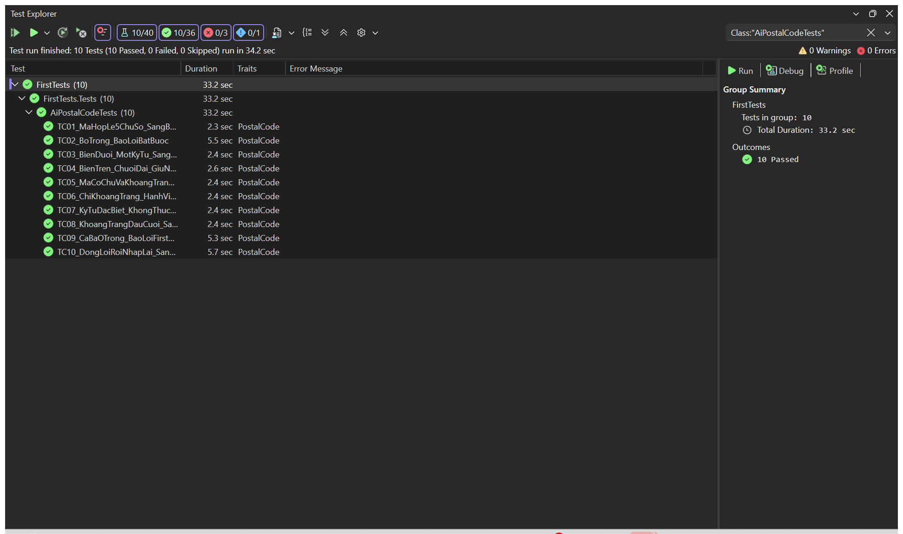

AI lần này đoán đúng hành vi chính của trang: chỉ bắt buộc ô không trống, không kiểm định dạng, không giới hạn độ dài. Nhưng xanh hết không có nghĩa là dùng được hết. Nhóm đọc từng ca và kiểm chứng thêm bằng một test tạm (đã xóa) thì thấy có chỗ sai.

### Các ca KHÔNG dùng được

| Ca | Vấn đề | Vì sao loại |
|---|---|---|
| **TC06** chỉ khoảng trắng | AI tự nhận đây là "lỗi tiềm ẩn" (trang nên chặn), nhưng lại viết `Assert.That(DaSangBuocHai(), Is.True)`, tức là khẳng định hành vi lỗi là đúng | **Kỳ vọng sai**: test sẽ xanh khi trang còn lỗi và đỏ đúng lúc lỗi được sửa. Một ca kiểm thử không được lấy lỗi làm kết quả mong đợi. Nếu coi đây là lỗi thì phải báo lỗi, không phải viết test cho nó đậu |
| **TC07** chuỗi `<script>alert(1)</script>` | Kiểm "không bật hộp thoại alert" sau khi sang bước 2 | **Kiểm một điều trang không có**: nhóm kiểm chứng thì trang bước 2 không hiển thị mã bưu chính ở đâu cả (`PageSource` không chứa chuỗi đã nhập), nên script không có chỗ nào để chạy. Câu Assert luôn đúng, không chứng minh được gì. Hàm phụ `CoHopThoaiAlert()` còn gọi `driver.SwitchTo()` thẳng trong file test, trái quy ước POM của Bài 4 |
| **TC10** đóng lỗi rồi nhập lại | Gọi `DienThongTin(Ho, Ten, "70000")` lần thứ hai | **Làm sai điều nó nói**: hai ô tên vẫn còn chữ cũ nên `SendKeys` gõ nối thêm. Nhóm kiểm chứng thì ô First Name thành `NguyenNguyen`, Last Name thành `AnAn`. Test vẫn xanh nhưng không kiểm đúng việc "nhập lại". Bản giữ lại thêm hàm `NhapLaiMaBuuChinh()` (xóa ô rồi gõ) và chỉ nhập lại ô mã |

Ngoài ra code AI còn **tự viết `[SetUp]` trong file test** (`MoTrangCheckout`), trái quy ước của Bài 5: file test không có `[SetUp]`, vòng đời nằm ở `BaseTest`.

### Các ca giữ lại

`Tests/CheckoutTests.cs` (`[Category("Checkout")]`) giữ 7 ca dùng được nguyên ý: TC01, TC02, TC03, TC04, TC05, TC08, TC09. Thêm TC10 đã sửa, tổng cộng 8 ca. Bản giữ lại dùng hàm `private MoTrangCheckout()` thay cho `[SetUp]`. Cả 8 ca đều Passed ở cả chế độ tuần tự lẫn song song.

### Nhận xét

Lần này AI không bịa luật như các bài trước, cả 10 ca chạy đều xanh. Nhưng 3/10 ca vẫn không dùng được, và cả 3 đều xanh nên chạy test không phát hiện ra: một ca lấy lỗi làm kỳ vọng, một ca kiểm điều không thể xảy ra, một ca làm khác điều tên nó nói. Bài học là test xanh chưa đủ, phải đọc từng câu Assert và tự hỏi "nếu trang sai thì câu này có đỏ không".

---

# Lab 5 — Xây dựng framework: cấu trúc, cấu hình & Data-Driven Testing

Nâng cấp bộ test của Bài 1–4 thành một framework nhỏ: cấu hình nằm trong file JSON, trình duyệt tạo qua `DriverFactory`, vòng đời trình duyệt gom vào `BaseTest`, còn dữ liệu đăng nhập đọc từ `Data/users.json`. Toàn bộ test chạy bằng **Test Explorer** của Visual Studio 2026, ảnh chụp nằm trong thư mục `screenshots/` (tên bắt đầu bằng `lab5_`).

Tiêu chí chính của bài là **đổi trình duyệt và thêm bộ dữ liệu mà không chạm vào file `.cs` nào**. Cả hai việc này nhóm đều đã làm được, có ảnh ở phần B và phần D bên dưới.

> Các phần Lab 4 trở xuống nhắc tới `Tests/TestBase.cs` và `DriverFactory.cs` ở thư mục gốc. Sau Lab 5 hai file này đã thành `Core/BaseTest.cs` và `Core/DriverFactory.cs`.

## Cấu trúc thư mục

```
FirstTests/
├── Config/
│   ├── appsettings.json      BaseUrl, Browser, TimeoutSeconds, Headless, WindowWidth/Height...
│   ├── TestConfig.cs         lớp ánh xạ 1-1 với file JSON
│   └── ConfigReader.cs       đọc file 1 lần theo AppContext.BaseDirectory
├── Core/
│   ├── DriverFactory.cs      Create(cfg) trả về IWebDriver: Chrome / Firefox / Edge
│   └── BaseTest.cs           [SetUp] + [TearDown] dùng chung cho mọi file test
├── Data/
│   ├── users.json            9 bộ dữ liệu đăng nhập
│   └── LoginData.cs          lớp Username / Password / ThanhCong / GhiChu
├── Pages/                    Page Object của Bài 4 (lấy URL, thời gian chờ từ config)
├── Tests/                    7 file test, tất cả đều ": BaseTest"
└── Utilities/
    └── ScreenshotHelper.cs   chụp ảnh khi test Failed (tách từ Bài 3)
```

Mỗi tầng chỉ có một lý do để sửa: đổi trang web hay thời gian chờ thì sửa `appsettings.json`, thêm trình duyệt thì sửa `DriverFactory`, đổi giao diện trang thì sửa `Pages/`, thêm ca đăng nhập thì sửa `users.json`.

## Phần A — Tầng Config

`appsettings.json` có 10 khóa, ngoài 4 khóa bắt buộc (`BaseUrl`, `Browser`, `TimeoutSeconds`, `Headless`) còn có `WindowWidth`, `WindowHeight`, `CheckTimeoutSeconds` (thời gian chờ ngắn cho các hàm hỏi CÓ/KHÔNG) và URL của 3 trang phụ dùng ở Bài 1 và Bài 3 (`TheInternetUrl`, `SeleniumHomeUrl`, `ExampleUrl`). Nhờ vậy cả 7 file test đều không còn URL viết cứng.

```json
{
  "BaseUrl": "https://www.saucedemo.com/",
  "Browser": "Chrome",
  "TimeoutSeconds": 10,
  "CheckTimeoutSeconds": 3,
  "Headless": false,
  "WindowWidth": 1366,
  "WindowHeight": 768,
  ...
}
```

- `FirstTests.csproj` thêm 2 gói `Microsoft.Extensions.Configuration.Json` và `.Binder` (10.0.12), và khai báo `CopyToOutputDirectory = PreserveNewest` cho **cả** `Config\appsettings.json` lẫn `Data\users.json`.
- `ConfigReader` lấy đường dẫn theo `AppContext.BaseDirectory` (luôn là `bin\Debug\net10.0\`) chứ không theo `Directory.GetCurrentDirectory()`. Nếu thiếu file thì báo rõ là kiểm tra lại `CopyToOutputDirectory`.
- Kiểm tra bằng **Find in Files** (`Ctrl+Shift+F`) của Visual Studio: tìm regex `https?://` trong `FirstTests`, kiểu file `*.cs` → **0 kết quả trên 19 file** (ảnh `lab5_A4_find_khong_con_url.png`).

| appsettings.json + cấu trúc | CopyToOutputDirectory trong .csproj |
|---|---|
| 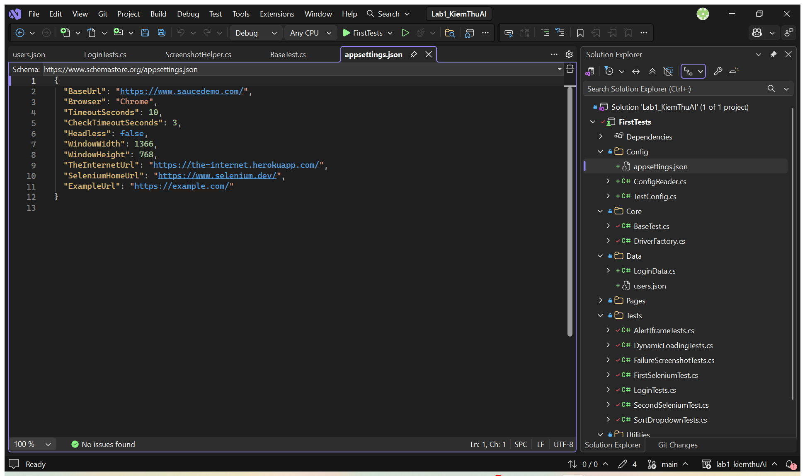 | 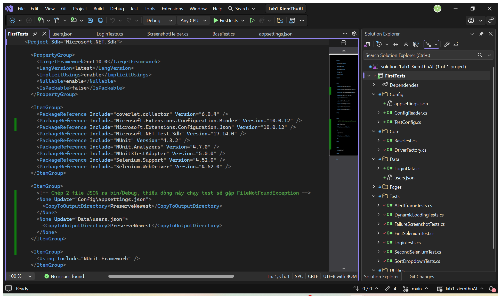 |

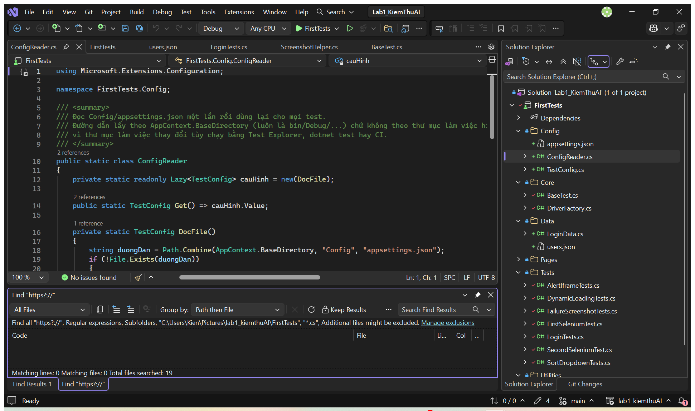

## Phần B — Driver Factory

```csharp
public static IWebDriver Create(TestConfig cfg)
{
    IWebDriver driver = cfg.Browser.Trim().ToLowerInvariant() switch
    {
        "chrome"  => new ChromeDriver(ChromeOpts(cfg)),
        "firefox" => new FirefoxDriver(FirefoxOpts(cfg)),
        "edge"    => new EdgeDriver(EdgeOpts(cfg)),
        _ => throw new NotSupportedException(
            $"Trình duyệt \"{cfg.Browser}\" không được hỗ trợ. " +
            "Khóa Browser trong appsettings.json chỉ nhận: Chrome, Firefox, Edge.")
    };
    driver.Manage().Window.Size = new Size(cfg.WindowWidth, cfg.WindowHeight);
    return driver;
}
```

- Hàm trả về `IWebDriver`, nên `BaseTest` và các Page không biết (và không cần biết) đang chạy trình duyệt nào.
- Headless áp cho cả 3 trình duyệt, mỗi cái đúng cú pháp của nó: Chrome/Edge dùng `--headless=new` và `--window-size=W,H`; Firefox dùng `--headless` và `--width` / `--height`. Kích thước cửa sổ đặt tường minh, không dùng `Maximize()`.
- Máy nhóm không cài Firefox nên phần chạy thật dùng **Chrome + Edge** (đề cho phép). Nhánh Firefox vẫn có đủ `FirefoxOpts(cfg)`.

**Cùng một code, chỉ đổi 1 chữ trong `appsettings.json`**: `"Browser": "Chrome"` → `"Browser": "Edge"`, bấm **Run All Tests** trong Test Explorer. Cả hai lần đều **19/19 Passed** (2 test `[Explicit]` cố ý rớt của Bài 3 không tự chạy).

| Chrome | Edge |
|---|---|
| 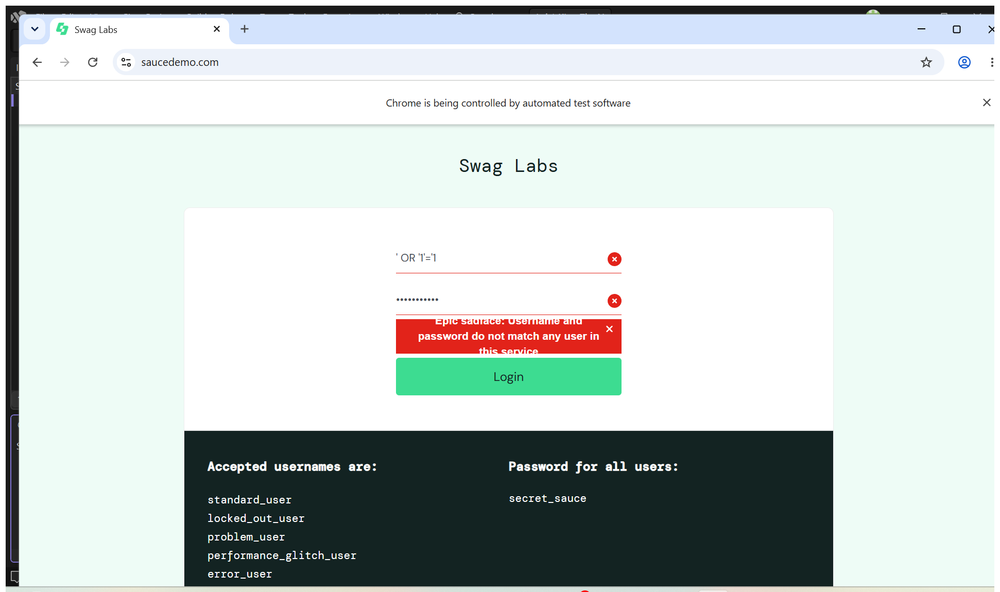 | 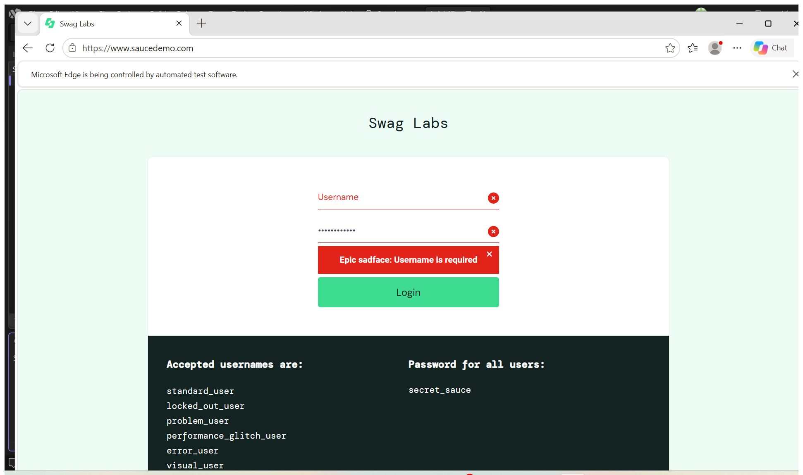 |
| 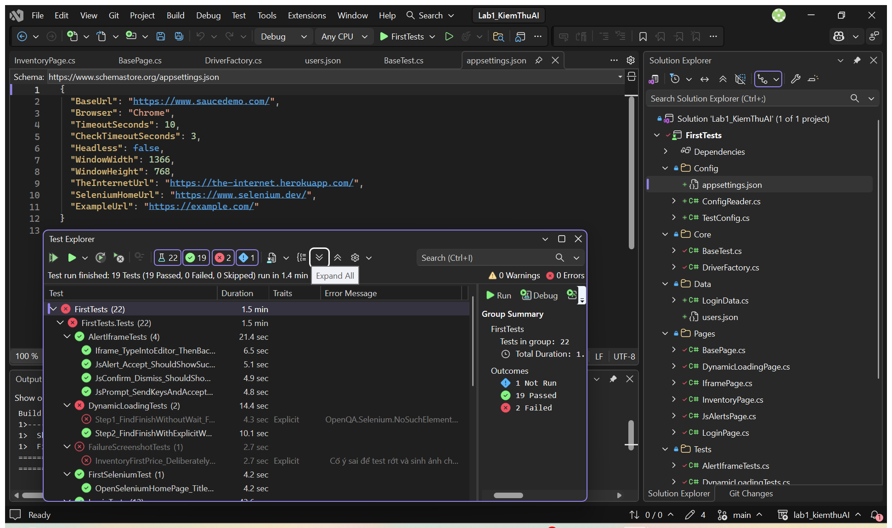 | 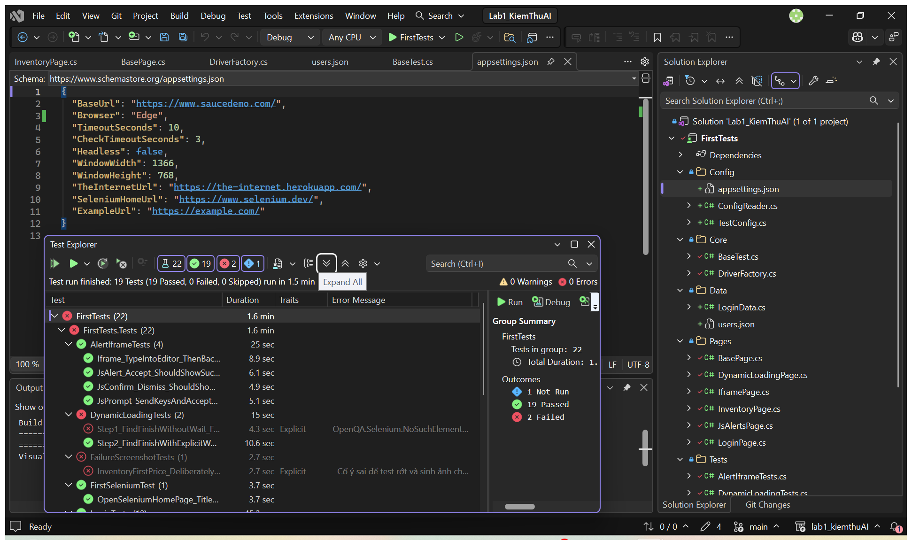 |

Thử gõ sai thành `"Safari"`: test rớt ngay với thông báo nêu đúng tên bị gõ:

```
System.NotSupportedException : Trình duyệt "Safari" không được hỗ trợ. Khóa Browser trong appsettings.json chỉ nhận: Chrome, Firefox, Edge.
```

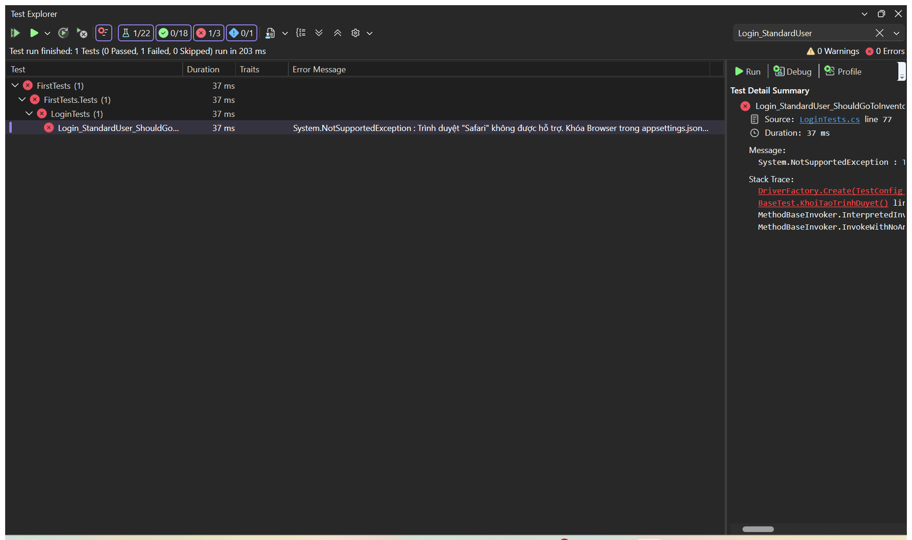

## Phần C — BaseTest

```csharp
public abstract class BaseTest
{
    protected IWebDriver driver = null!;
    protected TestConfig cfg = null!;

    [SetUp]
    public void KhoiTaoTrinhDuyet()
    {
        cfg = ConfigReader.Get();
        driver = DriverFactory.Create(cfg);
        driver.Navigate().GoToUrl(cfg.BaseUrl);
    }

    [TearDown]
    public void DongTrinhDuyet()
    {
        try
        {
            if (TestContext.CurrentContext.Result.Outcome.Status == TestStatus.Failed && driver != null)
            {
                string duongDan = ScreenshotHelper.Chup(driver, TestContext.CurrentContext.Test.Name);
                TestContext.AddTestAttachment(duongDan, "Ảnh chụp màn hình lúc test thất bại");
            }
        }
        catch (Exception ex) { Console.WriteLine($"Không chụp được ảnh: {ex.Message}"); }
        finally
        {
            driver?.Quit();
            driver?.Dispose();
        }
    }
}
```

- Chụp ảnh nằm trong `try`, `Quit()`/`Dispose()` nằm trong `finally`: chụp ảnh có lỗi thì trình duyệt vẫn được đóng.
- Cả 7 file test đều `: BaseTest`, kể cả 2 test của Bài 1 (`FirstSeleniumTest`, `SecondSeleniumTest`) trước đây tự `new ChromeDriver`. `LoginTests` bỏ luôn `[SetUp] MoTrangDangNhap()` vì `BaseTest` đã mở `BaseUrl`.
- Find in Files regex `\[SetUp\]|\[TearDown\]|new ChromeDriver` trong `FirstTests\Tests` → **0 kết quả trên 7 file** (ảnh `lab5_C3_find_khong_con_setup.png`).
- Chạy riêng test `[Explicit]` cố ý rớt của Bài 3: Test Explorer báo Failed, phần *Standard Output* có dòng "Đã chụp ảnh khi test rớt", có file đính kèm, ảnh nằm ở `bin\Debug\net10.0\FailureScreenshots\`. Sau khi chạy xong kiểm tra không còn tiến trình `chromedriver` nào chạy ngầm.

| try / finally | Test cố ý rớt có ảnh đính kèm |
|---|---|
| 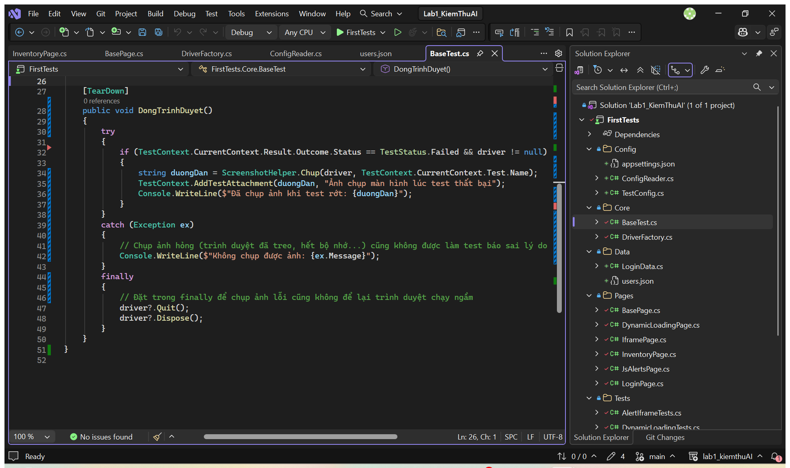 | 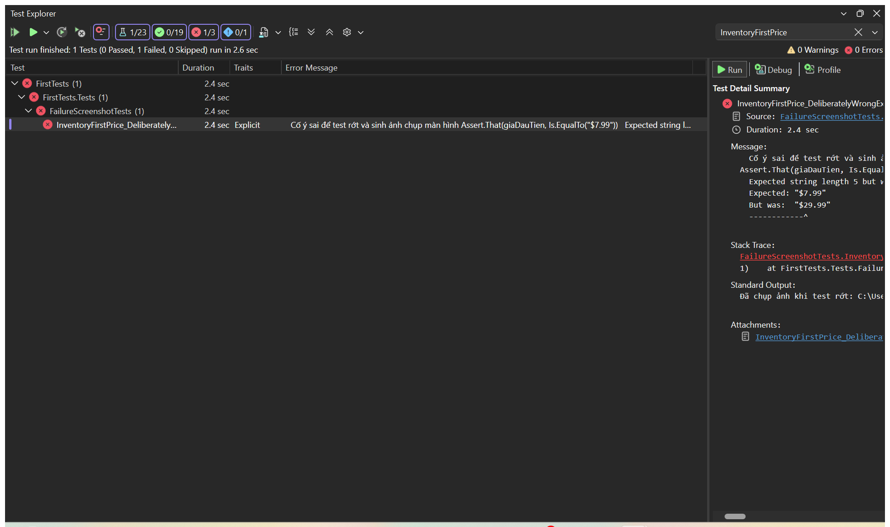 |

## Phần D — Data-Driven Testing

`Data/users.json` lúc đầu có **8 bộ**, trong đó có 5 ca biên:

| # | Username | Password | ThanhCong | Ghi chú |
|---|---|---|---|---|
| 01 | `standard_user` | `secret_sauce` | true | tài khoản chuẩn |
| 02 | `locked_out_user` | `secret_sauce` | false | bị khóa |
| 03 | *(trống)* | `secret_sauce` | false | **biên**: ô Username trống |
| 04 | `standard_user` | *(trống)* | false | **biên**: ô Password trống |
| 05 | `" standard_user "` | `secret_sauce` | false | **biên**: thừa khoảng trắng 2 đầu |
| 06 | `' OR '1'='1` | `' OR '1'='1` | false | **biên**: ký tự đặc biệt kiểu SQL injection |
| 07 | `aaa…a` (300 ký tự) | `secret_sauce` | false | **biên**: chuỗi rất dài |
| 08 | `problem_user` | `secret_sauce` | true | lỗi giao diện nhưng vẫn vào được |

```csharp
public static IEnumerable<TestCaseData> DuLieuDangNhap()
{
    List<LoginData> danhSach = LoginData.DocTuFile();
    for (int i = 0; i < danhSach.Count; i++)
    {
        LoginData u = danhSach[i];
        yield return new TestCaseData(u)
            .SetName($"DangNhap_{i + 1:00}_{TenGon(u.Username)}{(u.Password.Length == 0 ? "_MatKhauTrong" : "")}")
            .SetDescription(u.GhiChu);
    }
}

[TestCaseSource(nameof(DuLieuDangNhap))]
public void DangNhap_TheoDuLieu(LoginData u) { ... }
```

- Nguồn dữ liệu là `static`, trả về `IEnumerable<TestCaseData>`, gọi qua `nameof(...)`.
- Tên ca có số thứ tự nên 2 bộ cùng Username không bị trùng tên. `TenGon` bỏ ký tự lạ và cắt chuỗi dài (ca 300 ký tự hiện thành `DangNhap_07_aaaaaaaaaaaaaaaaaaaa_Dai300`).
- Kỳ vọng cũng là dữ liệu: `ThanhCong = true` thì Assert vào được trang sản phẩm và đúng URL; `false` thì Assert không vào được, có thông báo lỗi và vẫn ở trang đăng nhập.
- **Sửa `InventoryPage.DaHienThi()`**: bản Bài 4 dùng `wait.Until(d => d.FindElement(...))` chờ 10 giây. Giờ gọi hàm chung `CoHienThi()` trong `BasePage`: dùng `FindElements` (trả danh sách rỗng chứ không ném lỗi), chỉ chờ `CheckTimeoutSeconds` = 3 giây và bắt `WebDriverTimeoutException` để trả `false`. `LoginPage.ThongBaoLoiDaHienThi()` cũng đổi sang `CoHienThi()`. Mỗi ca nghịch giờ chạy khoảng 5 giây.

**Thêm dữ liệu không sửa code**: thêm bộ thứ 9 (`visual_user`, ThanhCong = true) vào `users.json` ngay trong editor của Visual Studio, bấm **Build > Rebuild Solution** để Test Explorer quét lại, rồi chạy lại nhóm `DangNhap`:

| | Trước | Sau |
|---|---|---|
| Số ca `DangNhap_*` | 8 | 9 |
| Kết quả | 8 Passed | 9 Passed |
| File thay đổi | | chỉ `FirstTests/Data/users.json` (+6 dòng) |

Lưu ý nhỏ: nếu chỉ sửa JSON rồi bấm Run ngay thì Test Explorer vẫn chạy 8 ca, vì file `.dll` không đổi nên VS không quét lại danh sách test. Rebuild xong mới hiện ca `DangNhap_09_visual_user`.

| Trước: 8 ca | Sau: 9 ca |
|---|---|
| 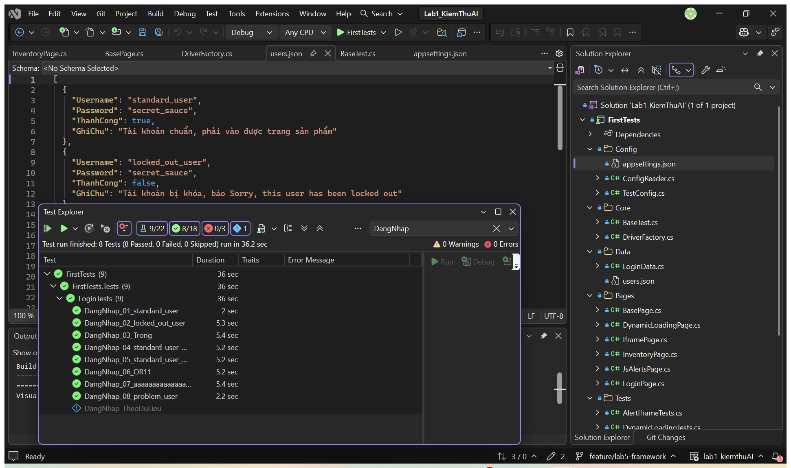 | 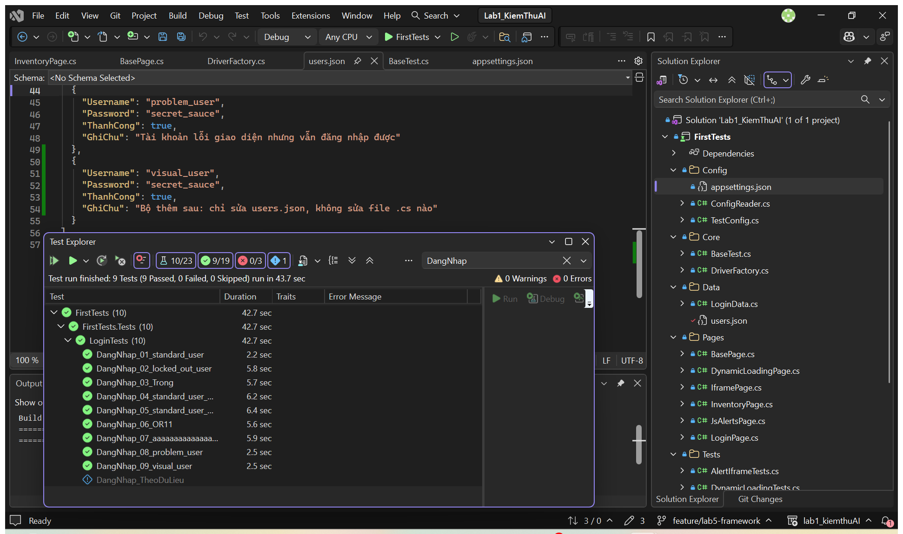 |

Commit `test: thêm bộ dữ liệu visual_user vào users.json` mở trong cửa sổ Git Repository của VS: **1 change, chỉ có users.json**.

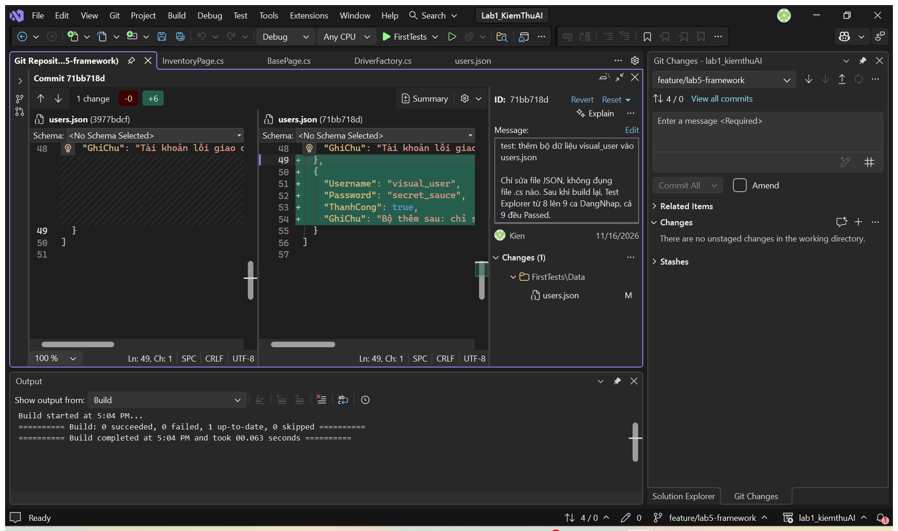

## Phần E — Thẩm định dữ liệu AI sinh

### Prompt đã dùng

Nhờ Claude (AI) sinh dữ liệu, prompt như sau:

> Mình đang viết test Selenium C# data-driven cho form đăng nhập của trang https://www.saucedemo.com. Sinh giúp mình 10 bộ dữ liệu test dạng mảng JSON, mỗi phần tử có đúng 4 khóa:
> - `Username` (string)
> - `Password` (string)
> - `ThanhCong` (bool): true nếu đăng nhập xong phải vào được trang sản phẩm, false nếu phải ở lại trang đăng nhập và báo lỗi
> - `GhiChu` (string): mô tả ngắn ca test
>
> Có cả ca thuận, ca nghịch và ca biên. Chỉ trả về JSON.

### Kết quả AI trả về

```json
[
  { "Username": "standard_user", "Password": "secret_sauce", "ThanhCong": true,
    "GhiChu": "AI 01: Đăng nhập hợp lệ với tài khoản chuẩn" },
  { "Username": "locked_out_user", "Password": "secret_sauce", "ThanhCong": false,
    "GhiChu": "AI 02: Tài khoản bị khóa, hiển thị thông báo lỗi" },
  { "Username": "problem_user", "Password": "secret_sauce", "ThanhCong": true,
    "GhiChu": "AI 03: Tài khoản có lỗi giao diện nhưng vẫn đăng nhập được" },
  { "Username": "performance_glitch_user", "Password": "secret_sauce", "ThanhCong": true,
    "GhiChu": "AI 04: Tài khoản phản hồi chậm nhưng cuối cùng vẫn đăng nhập thành công" },
  { "Username": "STANDARD_USER", "Password": "secret_sauce", "ThanhCong": true,
    "GhiChu": "AI 05: Tên đăng nhập không phân biệt chữ hoa chữ thường" },
  { "Username": "  standard_user", "Password": "secret_sauce", "ThanhCong": true,
    "GhiChu": "AI 06: Hệ thống tự loại bỏ khoảng trắng ở đầu tên đăng nhập" },
  { "Username": "", "Password": "", "ThanhCong": false,
    "GhiChu": "AI 07: Bỏ trống cả hai trường, hiển thị lỗi Username is required" },
  { "Username": "standard_user", "Password": "SECRET_SAUCE", "ThanhCong": false,
    "GhiChu": "AI 08: Mật khẩu phân biệt chữ hoa chữ thường" },
  { "Username": "<script>alert('xss')</script>", "Password": "secret_sauce", "ThanhCong": false,
    "GhiChu": "AI 09: Chèn mã script vào ô Username, không được thực thi và phải báo lỗi" },
  { "Username": "standard_user", "Password": "wrong_password", "ThanhCong": false,
    "GhiChu": "AI 10: Nhập sai mật khẩu lần thứ 3 liên tiếp thì tài khoản bị khóa tạm thời" }
]
```

### Cách kiểm tra

Nhóm không tin ngay mà dán thử cả 10 bộ vào `users.json` trên Visual Studio, Rebuild rồi chạy nhóm `DangNhap` (không commit bản này, chạy xong trả `users.json` về 9 bộ của nhóm). Kết quả: **8 Passed, 2 Failed**.

| Chạy thử 10 bộ AI | Chi tiết ca AI 05 |
|---|---|
| 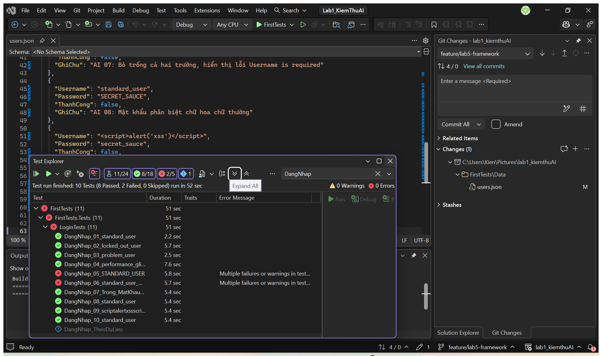 | 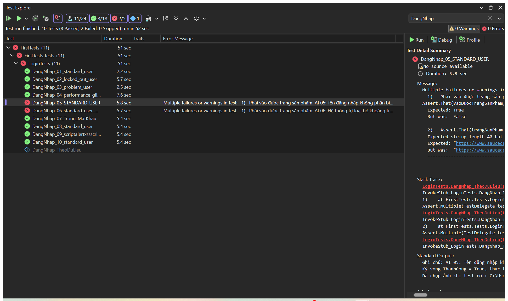 |

### Các bộ KHÔNG dùng được

1. **AI 05 — `STANDARD_USER`, kỳ vọng `true`: sai với hành vi thật.** Saucedemo phân biệt hoa thường ở Username, gõ `STANDARD_USER` thì trang báo *"Username and password do not match any user in this service"*. Test rớt: `Phải vào được trang sản phẩm... Expected: True But was: False`. AI tự suy ra "username không phân biệt hoa thường" vì nhiều hệ thống làm vậy, nhưng trang này thì không.
2. **AI 06 — `"  standard_user"` (2 dấu cách đầu), kỳ vọng `true`: sai với hành vi thật.** Saucedemo không tự cắt khoảng trắng, nên vẫn báo sai tài khoản và test rớt giống ca 05. Ca biên khoảng trắng của nhóm (bộ 05 trong `users.json`) để kỳ vọng `false` là đúng.
3. **AI 10 — "sai mật khẩu lần thứ 3 thì bị khóa tạm thời": test cho tính năng saucedemo không có.** Saucedemo không đếm số lần sai và không khóa tài khoản. Ca này vẫn **Passed**, nhưng là Passed vì nhập sai mật khẩu thì đương nhiên báo lỗi, chứ không phải vì có khóa tài khoản. Hơn nữa mỗi ca test mở một trình duyệt mới nên không thể có "lần thứ 3 liên tiếp". Ghi chú hứa kiểm một điều mà test không hề kiểm, giữ lại chỉ gây hiểu nhầm. Đây là loại nguy hiểm nhất vì chạy test **không** phát hiện ra, phải đọc mới thấy.

### Các bộ dùng được nhưng cần lưu ý

- **AI 04 — `performance_glitch_user`**: kỳ vọng đúng, chạy Passed (7,6 giây). Nhưng tài khoản này cố ý chậm, nếu mạng chậm hơn thì `DaHienThi()` chỉ chờ 3 giây có thể trả `false` trước khi trang kịp hiện. Muốn dùng lâu dài thì nên tăng `CheckTimeoutSeconds` hoặc để ca này chờ theo `TimeoutSeconds`.
- **AI 09 — chèn `<script>`**: kết quả đúng (báo sai tài khoản), nhưng ghi chú "không được thực thi" thì test không kiểm (không bắt alert). Nếu dùng nên sửa ghi chú cho đúng với cái test thật sự kiểm.
- **AI 07** trùng ý với ca trống Username của nhóm; **AI 01, 02, 03** trùng với tài khoản có sẵn trên trang, không có gì mới.

### Nhận xét

AI sinh dữ liệu đúng định dạng, đúng tên khóa (`Username`, `ThanhCong`...) nên dán vào là chạy được ngay, không bị lỗi lệch tên khóa. Phần sai nằm ở **kỳ vọng**: AI đoán hành vi của trang theo "thường thì hệ thống sẽ làm vậy" (không phân biệt hoa thường, tự cắt khoảng trắng, khóa sau 3 lần sai) chứ không biết saucedemo thật sự làm gì. 2 ca sai kỳ vọng thì chạy test là lộ ngay, còn ca bịa tính năng (AI 10) lại Passed nên chỉ phát hiện được khi đọc kỹ từng dòng ghi chú.

---

# Lab 4 — OOP trong kiểm thử & Page Object Model (POM)

Refactor bộ test của Bài 2–3 (trang https://www.saucedemo.com và https://the-internet.herokuapp.com) sang **Page Object Model** mà không đổi hành vi. Chạy test bằng **Test Explorer** của Visual Studio 2026.

> Các phần Lab 3 và Lab 2 bên dưới nhắc tới `Lab3TestBase.cs`, `Lab3/...`, `FirstTests/LoginTests.cs`. Sau Lab 4 các file đó nằm trong `FirstTests/Tests/`. Hai test của Bài 1 (`FirstSeleniumTest`, `SecondSeleniumTest`) không thuộc Bài 2–3 nên giữ nguyên.

## Cấu trúc (Phần A) và Page class (Phần B)

```
FirstTests/
├── Pages/                        namespace FirstTests.Pages
│   ├── BasePage.cs               abstract: driver, WebDriverWait, Tim(By)
│   ├── LoginPage.cs
│   ├── InventoryPage.cs
│   ├── DynamicLoadingPage.cs     Bài 3 phần A
│   ├── JsAlertsPage.cs           Bài 3 phần C (alert)
│   └── IframePage.cs             Bài 3 phần C (iframe)
└── Tests/                        namespace FirstTests.Tests
    ├── TestBase.cs               mở/đóng Chrome, chụp ảnh khi test rớt
    ├── LoginTests.cs             Bài 2
    ├── SortDropdownTests.cs      Bài 3 phần B, dùng chaining
    ├── DynamicLoadingTests.cs    Bài 3 phần A
    ├── AlertIframeTests.cs       Bài 3 phần C
    └── FailureScreenshotTests.cs Bài 3 phần D
```

- `BasePage` (abstract) chứa `driver`, `WebDriverWait` và hàm `Tim(By)` tìm phần tử kèm chờ. Mọi Page kế thừa `BasePage`, không khai báo lại `driver`/`wait`.
- Locator là `private readonly By`; hành vi nghiệp vụ là `public`, tên trả lời "người dùng làm được gì".
- `LoginPage`: `Mo()`, `DangNhap(tk, mk)` (trả về `InventoryPage`), `LayThongBaoLoi()`, `ThongBaoLoiDaHienThi()`, `LayUrl()`.
- `InventoryPage`: `DaHienThi()`, `SapXep(value)` (trả về `this`), `LayDanhSachGia()`, `LayDanhSachTenSanPham()`, `LayDanhSachGiaHienThi()`, `LayKieuSapXepDangChon()`, `LayGiaSanPhamDauTien()`, `LayUrl()`.
- Hành vi chuyển trang trả về `new TrangMoi(driver)`, hành vi ở lại trang trả về `this`.
- Toàn bộ test chỉ dùng Explicit Wait (trong Page), không bật Implicit Wait.

## Refactor test Bài 2–3 (Phần C)

Toàn bộ 11 ca chạy thường và 2 ca `[Explicit]` của Bài 2–3 được chuyển sang Page Object, không bỏ Assert nào. Tự chấm bằng 3 phép thử (Find in Files của Visual Studio, `Ctrl+Shift+F`):

| Phép thử | Tìm | Thư mục | Kết quả |
|---|---|---|---|
| Không có "By" trong test | `By` | `FirstTests\Tests` | 0 kết quả |
| Không có Assert trong Page | `Assert` | `FirstTests\Pages` | 0 kết quả |
| Không Page nào trả về `IWebElement` | `public[^=]*IWebElement` (regex) | `FirstTests\Pages` | 0 kết quả |

**Chạy test trước và sau refactor** bằng Test Explorer (Run All Tests, sau đó chọn riêng 2 test `[Explicit]` và bấm Run). "Trước" chạy trên nhánh `main` cũ, "sau" chạy trên code đã refactor:

| | Trước | Sau |
|---|---|---|
| Test chạy thường | 11 Passed, 0 Failed | 11 Passed, 0 Failed |
| Test `[Explicit]` (không tự chạy) | 2 Not Run | 2 Not Run |
| `Step1_FindFinishWithoutWait_Fails` (chạy riêng) | Failed — `NoSuchElementException ... #finish` | Failed — cùng lỗi |
| `InventoryFirstPrice_DeliberatelyWrongExpectation_Fails` (chạy riêng) | Failed — `Is.EqualTo("$7.99")`, thực tế `$29.99` | Failed — cùng Assert, cùng giá trị |

| Trước refactor | Sau refactor |
|---|---|
| 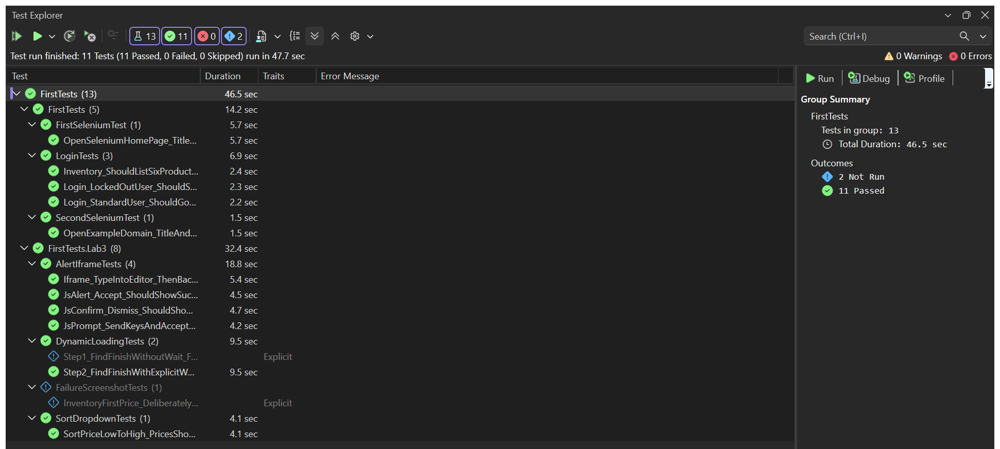 | 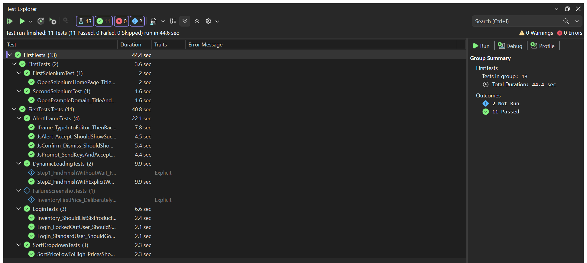 |
| 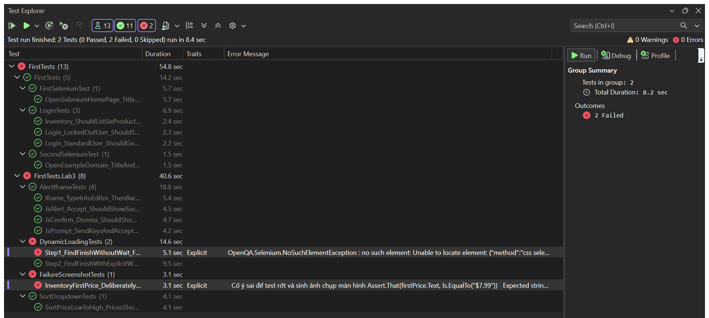 | 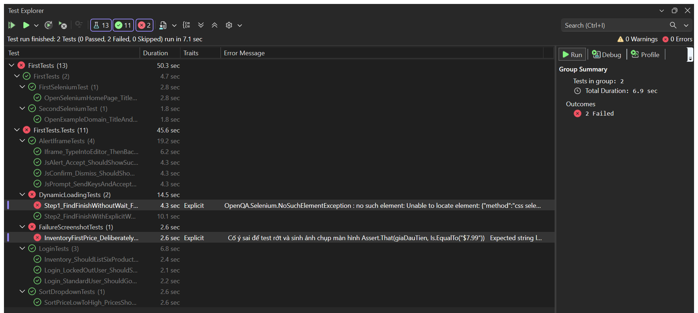 |

## Bài sắp xếp giá dùng POM + chaining (Phần D)

```csharp
InventoryPage trangSanPham = new LoginPage(driver).Mo()
    .DangNhap("standard_user", "secret_sauce")
    .SapXep("lohi");
List<decimal> prices = trangSanPham.LayDanhSachGia();

Assert.That(prices, Is.Ordered.Ascending);
```

Các Assert của Bài 3 gốc vẫn còn đủ: dropdown đang chọn đúng, có 6 giá, bằng danh sách đã sắp (`prices.Order()`), `Is.Ordered.Ascending`, giá đầu là nhỏ nhất, giá cuối là lớn nhất.

## Thẩm định AI (Phần E)

Nhờ một agent AI riêng (Claude, bắt đầu từ ngữ cảnh trống, không thấy code Page Object của nhóm) refactor file `LoginTests.cs` của Lab 2 sang POM.

### Prompt đã dùng

Prompt kèm nguyên file `LoginTests.cs` gốc (có trong lịch sử Git), phần yêu cầu như sau:

> Em đang refactor bộ test Selenium C# (NUnit 4.3.2, Selenium.WebDriver 4.52, .NET 10) cho trang https://www.saucedemo.com sang mô hình Page Object Model (POM). Anh/chị refactor giúp em file test bên dưới theo ĐÚNG các quy ước sau:
> 
> 1. Cấu trúc: thư mục `Pages/` (namespace `FirstTests.Pages`) và `Tests/` (namespace `FirstTests.Tests`).
> 2. `BasePage` là abstract class chứa: `driver`, `WebDriverWait` (10 giây) và hàm `Tim(By)` tìm phần tử KÈM chờ. Mọi Page class phải kế thừa `BasePage`, không tự khai báo lại `driver`/`wait`.
> 3. `LoginPage` có tối thiểu: `DangNhap(tk, mk)` (trả về `InventoryPage`) và `LayThongBaoLoi()`. `InventoryPage` có tối thiểu: `DaHienThi()` và các hàm lấy danh sách sản phẩm (tên, giá) mà test cần.
> 4. Locator để `private readonly By`; hành vi nghiệp vụ để `public`. Tên hành vi phải trả lời "người dùng LÀM ĐƯỢC GÌ" (đặt tên tiếng Việt không dấu), không đặt theo kiểu "trang có thẻ nào".
> 5. KHÔNG có `Assert` bên trong Page Object. KHÔNG Page Object nào trả về `IWebElement`.
> 6. Trong Page class dùng `Tim(locator)` thay cho `driver.FindElement(locator)`.
> 7. File test sau khi refactor KHÔNG còn chữ `By` nào (mở file bấm Ctrl+F gõ By phải không có kết quả); chỉ gọi Page Object rồi `Assert`.
> 8. Refactor là đổi CẤU TRÚC nhưng GIỮ NGUYÊN hành vi: mọi ca test và mọi Assert của file gốc phải còn đủ, kết quả chạy phải giống hệt trước khi refactor.
> 
> Hãy trả về toàn bộ code của `BasePage.cs`, `LoginPage.cs`, `InventoryPage.cs` và `LoginTests.cs` đã refactor.

### Kết quả AI trả về

AI trả về 4 file. Code nguyên văn:

<details>
<summary>Pages/BasePage.cs</summary>

```csharp
using OpenQA.Selenium;
using OpenQA.Selenium.Support.UI;

namespace FirstTests.Pages;

public abstract class BasePage
{
    protected readonly IWebDriver driver;
    protected readonly WebDriverWait wait;

    protected BasePage(IWebDriver driver)
    {
        this.driver = driver;
        wait = new WebDriverWait(driver, TimeSpan.FromSeconds(10));
    }

    /// <summary>Tìm phần tử kèm chờ tối đa 10 giây.</summary>
    protected IWebElement Tim(By locator)
    {
        return wait.Until(d => d.FindElement(locator));
    }
}
```

</details>

<details>
<summary>Pages/LoginPage.cs</summary>

```csharp
using OpenQA.Selenium;

namespace FirstTests.Pages;

public class LoginPage : BasePage
{
    private readonly By oTenDangNhap = By.Id("user-name");
    private readonly By oMatKhau = By.Id("password");
    private readonly By nutDangNhap = By.Id("login-button");
    private readonly By thongBaoLoi = By.CssSelector("[data-test='error']");

    public LoginPage(IWebDriver driver) : base(driver)
    {
    }

    /// <summary>Nhập tài khoản, mật khẩu, bấm Login và trả về trang sản phẩm.</summary>
    public InventoryPage DangNhap(string tk, string mk)
    {
        Tim(oTenDangNhap).SendKeys(tk);
        Tim(oMatKhau).SendKeys(mk);
        Tim(nutDangNhap).Click();
        return new InventoryPage(driver);
    }

    public string LayThongBaoLoi()
    {
        return Tim(thongBaoLoi).Text;
    }

    public bool ThongBaoLoiDangHienThi()
    {
        return Tim(thongBaoLoi).Displayed;
    }
}
```

</details>

<details>
<summary>Pages/InventoryPage.cs</summary>

```csharp
using OpenQA.Selenium;

namespace FirstTests.Pages;

public class InventoryPage : BasePage
{
    private readonly By danhSachSanPham = By.CssSelector("[data-test='inventory-list']");
    private readonly By moiSanPham = By.CssSelector("[data-test='inventory-item']");
    private readonly By tenSanPham = By.CssSelector("[data-test='inventory-item-name']");
    private readonly By giaSanPham = By.CssSelector("[data-test='inventory-item-price']");

    public InventoryPage(IWebDriver driver) : base(driver)
    {
    }

    /// <summary>Chờ danh sách sản phẩm hiện ra; trang đã hiển thị thì trả về true.</summary>
    public bool DaHienThi()
    {
        return Tim(danhSachSanPham) != null;
    }

    public List<string> LayDanhSachTenSanPham()
    {
        return LayChuTrongTungSanPham(tenSanPham);
    }

    public List<string> LayDanhSachGiaSanPham()
    {
        return LayChuTrongTungSanPham(giaSanPham);
    }

    // Lấy thông tin BÊN TRONG từng sản phẩm bằng item.FindElement
    private List<string> LayChuTrongTungSanPham(By locatorBenTrong)
    {
        Tim(moiSanPham);
        var ketQua = new List<string>();
        foreach (IWebElement item in driver.FindElements(moiSanPham))
        {
            ketQua.Add(item.FindElement(locatorBenTrong).Text);
        }
        return ketQua;
    }
}
```

</details>

<details>
<summary>Tests/LoginTests.cs</summary>

```csharp
using FirstTests.Pages;
using OpenQA.Selenium;
using OpenQA.Selenium.Chrome;

namespace FirstTests.Tests;

[TestFixture]
public class LoginTests
{
    private const string BaseUrl = "https://www.saucedemo.com/";

    private IWebDriver driver = null!;
    private LoginPage loginPage = null!;

    [SetUp]
    public void SetUp()
    {
        var options = new ChromeOptions();
        // Tắt trình quản lý mật khẩu để Chrome không hiện popup cảnh báo mật khẩu sau khi đăng nhập
        options.AddUserProfilePreference("credentials_enable_service", false);
        options.AddUserProfilePreference("profile.password_manager_enabled", false);
        options.AddUserProfilePreference("profile.password_manager_leak_detection", false);

        driver = new ChromeDriver(options);
        driver.Manage().Window.Maximize();
        driver.Manage().Timeouts().ImplicitWait = TimeSpan.FromSeconds(5);
        driver.Navigate().GoToUrl(BaseUrl);

        loginPage = new LoginPage(driver);
    }

    [TearDown]
    public void TearDown()
    {
        driver?.Quit();
        driver?.Dispose();
    }

    [Test]
    public void Login_StandardUser_ShouldGoToInventoryPage()
    {
        InventoryPage inventoryPage = loginPage.DangNhap("standard_user", "secret_sauce");

        // Chờ danh sách sản phẩm hiện ra rồi mới kiểm tra URL
        inventoryPage.DaHienThi();
        Console.WriteLine($"URL sau khi đăng nhập: {driver.Url}");

        Assert.That(driver.Url, Is.EqualTo(BaseUrl + "inventory.html"),
            "Đăng nhập đúng phải chuyển sang trang inventory.html");
    }

    [Test]
    public void Login_LockedOutUser_ShouldShowErrorMessage()
    {
        loginPage.DangNhap("locked_out_user", "secret_sauce");

        string noiDungLoi = loginPage.LayThongBaoLoi();
        bool loiDangHienThi = loginPage.ThongBaoLoiDangHienThi();
        Console.WriteLine($"Thông báo lỗi: {noiDungLoi}");

        Assert.Multiple(() =>
        {
            Assert.That(loiDangHienThi, Is.True, "Thông báo lỗi phải hiện ra");
            Assert.That(noiDungLoi, Is.EqualTo("Epic sadface: Sorry, this user has been locked out."),
                "Nội dung thông báo lỗi không đúng");
            Assert.That(driver.Url, Is.EqualTo(BaseUrl), "Tài khoản bị khóa thì phải ở lại trang đăng nhập");
        });
    }

    [Test]
    public void Inventory_ShouldListSixProductsWithValidNameAndPrice()
    {
        InventoryPage inventoryPage = loginPage.DangNhap("standard_user", "secret_sauce");

        List<string> names = inventoryPage.LayDanhSachTenSanPham();
        List<string> prices = inventoryPage.LayDanhSachGiaSanPham();

        for (int i = 0; i < names.Count; i++)
        {
            Console.WriteLine($"{names[i]} - {prices[i]}");
        }

        Assert.Multiple(() =>
        {
            Assert.That(names, Has.Count.EqualTo(6), "Trang inventory phải có đúng 6 sản phẩm");
            Assert.That(names, Has.None.Empty, "Không được có tên sản phẩm rỗng");
            Assert.That(names, Is.Unique, "Tên sản phẩm không được trùng nhau");
            Assert.That(names, Does.Contain("Sauce Labs Backpack"), "Danh sách phải có sản phẩm Sauce Labs Backpack");
            Assert.That(prices, Has.All.StartWith("$"), "Mọi giá đều phải bắt đầu bằng ký tự $");
            Assert.That(prices.Select(p => decimal.Parse(p.TrimStart('$'), System.Globalization.CultureInfo.InvariantCulture)),
                Has.All.GreaterThan(0m), "Giá sản phẩm phải là số dương");
            Assert.That(prices[names.IndexOf("Sauce Labs Backpack")], Is.EqualTo("$29.99"),
                "Giá của Sauce Labs Backpack phải là $29.99");
        });
    }
}
```

</details>

### AI làm đúng

3 phép thử cứng đều đạt trên code của AI (không "By" trong file test, không Assert trong Page, không Page nào trả về `IWebElement`); `BasePage` abstract có `driver`, `wait`, `Tim`; locator `private readonly By`; `DangNhap` trả `InventoryPage`. Nhóm chép 4 file vào project tạm, build và chạy: **3/3 test Passed**.

### AI làm sai hoặc chưa đúng quy ước

1. **Giữ `ImplicitWait` trong test** (`LoginTests.cs`, dòng `driver.Manage().Timeouts().ImplicitWait = TimeSpan.FromSeconds(5);`) trong khi `BasePage.Tim` dùng Explicit Wait. Trộn hai loại chờ là điều Bài 3 đã cảnh báo: mỗi lần `FindElement` bên trong vòng chờ lại bị Implicit Wait giữ thêm tối đa 5 giây nên thời gian chờ thực tế không còn là 10 giây. (Nhóm chưa đo số giây cụ thể; đây là hành vi Selenium đã biết, test vẫn Passed vì các phần tử đều có mặt.)
2. **`DaHienThi()` không làm đúng tên**: `return Tim(danhSachSanPham) != null;`. `Tim` không bao giờ trả `null` (hoặc trả phần tử, hoặc ném `WebDriverTimeoutException`), nên hàm **không bao giờ trả `false`** và không kiểm tra phần tử có `Displayed`. Trong test AI còn gọi `inventoryPage.DaHienThi();` rồi bỏ qua giá trị trả về. Tên hàm hứa "đã hiển thị" nhưng thực tế không kiểm gì ngoài việc tìm thấy.
3. **Trong Page dùng `driver.FindElements` trực tiếp**, trái quy ước "dùng `Tim(locator)` thay cho `driver.FindElement(locator)`". `Tim(moiSanPham)` chỉ chờ phần tử đầu tiên rồi mới lấy cả danh sách, nên không chắc đã đủ sản phẩm lúc lấy tên và giá.
4. **Chưa gom phần dùng chung, vi phạm DRY**: file test vẫn tự tạo `ChromeDriver`, tự viết `SetUp`/`TearDown`, hard-code `BaseUrl` và đọc `driver.Url` trực tiếp (không có `LoginPage.Mo()` hay `LayUrl()`). Có 5 file test thì phải chép lại 5 lần. Nhóm đưa phần này vào `Tests/TestBase.cs` và `LayUrl()` của Page.

Không có lỗi nào trong 4 điểm trên làm test rớt, nên chỉ bắt được nhờ **đọc code** chứ không phải nhờ chạy test.

**Bài học:** AI làm đúng các tiêu chí kiểm bằng máy (tìm "By", tìm "Assert") nhưng bỏ sót các quy ước về ý nghĩa (tên hàm có đúng việc nó làm không, có trộn hai kiểu chờ không, có lặp code không).

---

# Lab 3 — Xử lý các tình huống thực tế phức tạp

Làm tiếp trên repo của Lab 1–2. Code Lab 3 nằm trong `FirstTests/Lab3/`, dùng lớp cơ sở `Lab3TestBase` chỉ có **Explicit Wait** (`WebDriverWait`, 10 giây), không bật Implicit Wait, không dùng `Thread.Sleep`. Đã thêm gói `Selenium.Support`.

## Phần A — Chứng minh vấn đề đồng bộ (`DynamicLoadingTests.cs`)

Trang: https://the-internet.herokuapp.com/dynamic_loading/2 — bấm **Start** thì vài giây sau JavaScript mới tạo ra phần tử `#finish` chứa chữ "Hello World!".

| Bước | Test | Kết quả | Ảnh |
|---|---|---|---|
| 1 — không chờ | `Step1_FindFinishWithoutWait_Fails`: tìm `#finish` ngay sau khi bấm Start | **Rớt**, `NoSuchElementException: no such element: Unable to locate element: {"method":"css selector","selector":"#finish"}` | `screenshots/lab3_A1_no_wait_failed.png` |
| 2 — Explicit Wait | `Step2_FindFinishWithExplicitWait_Passes`: `wait.Until(d => ...FindElement(By.Id("finish")) ...)` | **Pass**, đọc được "Hello World!" | `screenshots/lab3_A2_explicit_wait_passed.png` |
| Kiểm tra lại | Chạy bước 2 liên tiếp 10 lần | 10/10 Passed | `screenshots/lab3_A3_explicit_wait_10_runs.png` |

Test bước 1 được gắn `[Explicit]` để Run All vẫn xanh; muốn xem lại lỗi thì chạy riêng: `dotnet test --filter Name=Step1_FindFinishWithoutWait_Fails`.

**Vì sao cùng một code mà kết quả khác nhau?** Selenium chỉ tự chờ trang tải xong khi chuyển trang, còn phần tử `#finish` thì được JavaScript tạo ra vài giây sau khi bấm Start, lúc trang đã tải xong từ lâu. Ở bước 1, `FindElement` chạy ngay lập tức khi `#finish` chưa tồn tại nên ném `NoSuchElementException`; kết quả phụ thuộc vào tốc độ mạng và máy, nên kiểu test này có thể lúc rớt lúc qua (flaky). Ở bước 2, `WebDriverWait.Until(...)` hỏi lại DOM liên tục tới khi `#finish` xuất hiện (tối đa 10 giây), nên test luôn đợi đúng lúc phần tử có mặt và pass ổn định.

## Phần B — Dropdown & Assert đúng nghiệp vụ (`SortDropdownTests.cs`)

Đăng nhập saucedemo bằng `standard_user`, dùng `SelectElement` chọn **Price (low to high)** trên dropdown `product_sort_container`, lấy 6 giá bằng `FindElements`, bỏ ký tự `$` rồi chuyển sang `decimal`. Kết quả in ra: `7.99, 9.99, 15.99, 15.99, 29.99, 49.99`.

Assert không chỉ đếm số lượng:
- Danh sách giá bằng **chính nó sau khi sắp xếp tăng dần** (`prices` == `prices.OrderBy(p => p)`), và `Is.Ordered.Ascending`.
- Giá đầu là nhỏ nhất, giá cuối là lớn nhất; dropdown đang chọn đúng "Price (low to high)".

Lỗi gặp khi làm: đọc lại lựa chọn dropdown sau khi sắp xếp bị `StaleElementReferenceException` vì trang vẽ lại dropdown — sửa bằng cách tìm lại phần tử. Ảnh: `screenshots/lab3_B_sort_price_passed.png`.

## Phần C — Alert & iframe (`AlertIframeTests.cs`)

Trang https://the-internet.herokuapp.com/javascript_alerts — chờ alert bằng `wait.Until(d => d.SwitchTo().Alert())`, Assert `alert.Text` **trước** khi xử lý, sau đó Assert `#result`:

| Ca | Thao tác | Assert `alert.Text` | Assert `#result` |
|---|---|---|---|
| JS Alert | `Accept()` | `I am a JS Alert` | `You successfully clicked an alert` |
| JS Confirm | `Dismiss()` | `I am a JS Confirm` | `You clicked: Cancel` |
| JS Prompt | `SendKeys("Xin chao Selenium")` + `Accept()` | `I am a JS prompt` | `You entered: Xin chao Selenium` |

Trang https://the-internet.herokuapp.com/iframe — `SwitchTo().Frame("mce_0_ifr")`, chờ TinyMCE khởi tạo xong, chọn hết (Ctrl+A) rồi gõ đoạn chữ vào trình soạn thảo, Assert nội dung đã gõ; sau đó `SwitchTo().DefaultContent()` và đọc được tiêu đề trang chính.

Lỗi gặp khi làm: lần đầu chữ không vào được trình soạn thảo vì test vào iframe khi TinyMCE chưa khởi tạo xong và `Clear()` không dùng được với vùng `contenteditable` — sửa bằng cách chờ thân trình soạn thảo sẵn sàng và dùng Ctrl+A. Ảnh: `screenshots/lab3_C_alert_iframe_passed.png`.

## Phần D — Chụp ảnh khi test thất bại (`Lab3TestBase.cs`)

Trong `[TearDown]` của lớp cơ sở (dùng chung cho mọi test Lab 3):

```csharp
if (TestContext.CurrentContext.Result.Outcome.Status == TestStatus.Failed && driver != null)
{
    string dir = Path.Combine(TestContext.CurrentContext.WorkDirectory, "FailureScreenshots");
    Directory.CreateDirectory(dir);
    string path = Path.Combine(dir, $"{TestContext.CurrentContext.Test.Name}.png");
    ((ITakesScreenshot)driver).GetScreenshot().SaveAsFile(path);
    TestContext.AddTestAttachment(path, "Ảnh chụp màn hình lúc test thất bại");
}
```

- Chỉ chụp khi `Outcome.Status == TestStatus.Failed` (cần `using NUnit.Framework.Interfaces;`); test pass thì không sinh ảnh.
- Tên file ảnh = tên ca test; đính kèm vào kết quả bằng `TestContext.AddTestAttachment(path)`.
- Test cố ý rớt: `FailureScreenshotTests.InventoryFirstPrice_DeliberatelyWrongExpectation_Fails` (mong đợi giá đầu là `$7.99` nhưng thật là `$29.99`), gắn `[Explicit]`.
- Ảnh minh chứng: `screenshots/lab3_D_InventoryFirstPrice_DeliberatelyWrongExpectation_Fails.png` (ảnh do test tự chụp) và `screenshots/lab3_D_failed_test_console.png` (kết quả rớt kèm đường dẫn ảnh).


## Phần E — AI chẩn đoán flaky test

**Test chọn:** `DynamicLoadingTests.Step1_FindFinishWithoutWait_Fails` (tình huống Phần A). Trước khi hỏi, em chạy test này 10 lần liên tiếp: **rớt 10/10 lần**, mỗi lần 4–9 giây.

### Prompt đã dùng

> Em có một test Selenium C# (NUnit 4.3.2, Selenium.WebDriver 4.52.0, Chrome 157, .NET 10, Windows 11, chạy bằng dotnet test trên máy cá nhân, mạng wifi bình thường, không chạy song song) bị rớt. Code:
>
> ```csharp
> [SetUp]
> public void SetUp()
> {
>     driver = new ChromeDriver(options);
>     driver.Manage().Window.Maximize();
>     wait = new WebDriverWait(driver, TimeSpan.FromSeconds(10));
>     // không bật ImplicitWait
> }
>
> [Test]
> public void Step1_FindFinishWithoutWait_Fails()
> {
>     driver.Navigate().GoToUrl("https://the-internet.herokuapp.com/dynamic_loading/2");
>     driver.FindElement(By.CssSelector("#start button")).Click();
>
>     IWebElement finish = driver.FindElement(By.Id("finish"));
>
>     Assert.That(finish.Text, Is.EqualTo("Hello World!"));
> }
> ```
>
> Lỗi nguyên văn:
> `OpenQA.Selenium.NoSuchElementException : no such element: Unable to locate element: {"method":"css selector","selector":"#finish"} (Session info: chrome=157.0.8103.38); For documentation on this error, please visit: https://www.selenium.dev/documentation/webdriver/troubleshooting/errors#nosuchelementexception`
>
> Tần suất: em chạy 10 lần liên tiếp thì rớt cả 10 lần (mỗi lần khoảng 4–9 giây). Khi em mở trang bằng tay, bấm Start thì thấy hiện thanh loading vài giây rồi mới hiện chữ "Hello World!".
>
> Anh/chị chẩn đoán giúp em các nguyên nhân có thể khiến test này rớt hoặc chập chờn (liệt kê từng nguyên nhân), và cách sửa đúng ạ. Bài yêu cầu không được dùng Thread.Sleep.

### Câu trả lời của AI (Claude)

> ## Chẩn đoán
>
> Test rớt **10/10 lần** nên đây là lỗi xảy ra mọi lần, không phải test chập chờn (flaky). Nguyên nhân chính là test đang chạy đua với trang web và lần nào cũng thua.
>
> **Các nguyên nhân có thể:**
>
> 1. **Không chờ phần tử xuất hiện (nguyên nhân chính).** Ở `dynamic_loading/2`, thẻ `#finish` **chưa có trong DOM** lúc bấm Start. Trang hiện thanh loading vài giây rồi mới thêm `#finish` vào. `FindElement` được gọi ngay sau `Click()` nên không tìm thấy và ném `NoSuchElementException`. Lỗi ghi `css selector "#finish"` là bình thường, vì Selenium tự đổi `By.Id` sang CSS.
>
> 2. **ImplicitWait đang bằng 0.** Em không bật ImplicitWait, nên `FindElement` tìm đúng một lần rồi ném lỗi luôn. Biến `wait` đã tạo trong `SetUp` nhưng chưa được dùng ở đâu.
>
> 3. **Chờ sai điều kiện.** Nếu chỉ chờ phần tử *có trong DOM* thì vẫn có thể rớt: `#finish` có thể có rồi nhưng chưa hiển thị, khi đó `.Text` trả về chuỗi rỗng. Với `/dynamic_loading/1` thì `#finish` có sẵn nhưng bị ẩn, nên lỗi sẽ là assert sai chứ không phải NoSuchElement. Cần chờ **hiển thị và có chữ**.
>
> 4. **Timeout quá ngắn khi server chậm.** Sau khi sửa, test vẫn có thể thỉnh thoảng rớt với `WebDriverTimeoutException`. Lý do là the-internet.herokuapp.com đôi khi phản hồi chậm (server lâu không có truy cập phải khởi động lại, hoặc wifi chậm). Timeout 10 giây thường đủ, nhưng có thể tăng lên 15 giây.
>
> 5. **Bấm nút trước khi trang tải xong (ít gặp).** Khi đó nút Start có thể chưa sẵn sàng để bấm. Nên chờ nút bấm được rồi mới `Click()`.
>
> ## Cách sửa (dùng explicit wait, không dùng Thread.Sleep)
>
> ```csharp
> [Test]
> public void Step2_FindFinishWithExplicitWait_Passes()
> {
>     driver.Navigate().GoToUrl("https://the-internet.herokuapp.com/dynamic_loading/2");
>
>     // Chờ nút Start hiển thị và bấm được
>     IWebElement start = wait.Until(d =>
>     {
>         var btn = d.FindElement(By.CssSelector("#start button"));
>         return (btn.Displayed && btn.Enabled) ? btn : null;
>     });
>     start.Click();
>
>     // Chờ #finish xuất hiện, hiển thị và có chữ
>     wait.IgnoreExceptionTypes(typeof(NoSuchElementException),
>                               typeof(StaleElementReferenceException));
>     IWebElement finish = wait.Until(d =>
>     {
>         var el = d.FindElement(By.Id("finish"));
>         return (el.Displayed && !string.IsNullOrWhiteSpace(el.Text)) ? el : null;
>     });
>
>     Assert.That(finish.Text, Is.EqualTo("Hello World!"));
> }
> ```
>
> **Lưu ý:**
> - `IgnoreExceptionTypes` giúp `Until` thử lại liên tục (mặc định mỗi 500 ms) thay vì dừng ngay ở lỗi `NoSuchElementException` đầu tiên.
> - Không nên dùng chung ImplicitWait và explicit wait, vì thời gian chờ có thể cộng dồn khó đoán. Em đang không bật ImplicitWait là đúng.
> - `ExpectedConditions` cũ đã bị bỏ khỏi Selenium. Nếu muốn dùng thì cài thêm gói `DotNetSeleniumExtras.WaitHelpers`, còn viết lambda như trên thì không cần.

### Tự kiểm chứng từng gợi ý

| # | Gợi ý của AI | Cách em kiểm chứng | Kết luận |
|---|---|---|---|
| 1 | Không chờ phần tử, `#finish` chưa có trong DOM lúc bấm Start | Mở trang /2, đếm thời gian từ lúc bấm Start: trước khi bấm không có `#finish`; khoảng **5,0 giây** sau mới xuất hiện | **Đúng** — đây là nguyên nhân chính |
| 2 | ImplicitWait = 0, biến `wait` tạo ra nhưng không dùng | Đọc lại code bước 1: đúng là không gọi `wait.Until`; bước 2 dùng `wait.Until` thì pass 10/10 | **Đúng** |
| 3 | Chỉ chờ "có trong DOM" chưa đủ, phải chờ hiển thị và có chữ; ở /1 `#finish` có sẵn nhưng ẩn | Ở /2, lúc `#finish` vừa xuất hiện đã hiển thị và có sẵn chữ "Hello World!". Ở /1, `#finish` có sẵn với `display: none` | **Đúng với /1, không ảnh hưởng tới /2** — vẫn nên kiểm tra `Displayed` cho chắc |
| 4 | Server chậm có thể gây `WebDriverTimeoutException`, nên tăng timeout lên 15 giây | Trong 10 lần chạy bước 2 + 5 lần chạy code của AI không lần nào timeout; `#finish` xuất hiện sau khoảng 5 giây, còn dư nhiều so với 10 giây | **Có thể xảy ra nhưng chưa gặp** — giữ 10 giây |
| 5 | Bấm Start trước khi trang tải xong | `Navigate().GoToUrl()` đã tự chờ trang tải xong (pageLoadStrategy = normal); cả 10 lần rớt đều rớt ở dòng tìm `#finish`, chưa lần nào lỗi ở nút Start | **Không liên quan** tới lỗi này |
| — | Lưu ý: phải gọi `IgnoreExceptionTypes(typeof(NoSuchElementException))` thì `Until` mới thử lại | Code bước 2 của em **không** gọi `IgnoreExceptionTypes` mà vẫn pass 10/10, vì `WebDriverWait` của .NET mặc định đã bỏ qua `NotFoundException` (lớp cha của `NoSuchElementException`) | **Sai / thừa** |
| — | Code sửa của AI | Chạy thử nguyên đoạn code AI đưa 5 lần (`[Repeat(5)]`) | Pass 5/5 |

### Nhận xét

AI chẩn đoán đúng nguyên nhân chính: `FindElement` chạy ngay sau khi bấm Start trong khi `#finish` khoảng 5 giây sau mới được JavaScript thêm vào DOM, và AI cũng nhận ra từ con số 10/10 rằng đây là lỗi lần nào cũng xảy ra chứ không hẳn là flaky. Gợi ý chờ phần tử hiển thị và có chữ là đúng cho trang /1, còn với trang /2 thì không cần thiết vì phần tử vừa xuất hiện đã có chữ. Gợi ý "bấm Start trước khi trang tải xong" không liên quan, vì Selenium đã tự chờ trang tải và lỗi luôn nằm ở dòng tìm `#finish`. Lưu ý về `IgnoreExceptionTypes` là thừa, vì `WebDriverWait` mặc định đã bỏ qua `NotFoundException`, code của em không có dòng đó vẫn pass 10/10. Vì vậy em giữ cách sửa của mình ở Phần A và chỉ thêm kiểm tra `Displayed`, không tăng timeout khi chưa có bằng chứng server chậm.

---

# Lab 2 — Selenium WebDriver cơ bản: tương tác với trình duyệt và phần tử web

Trang kiểm thử: https://www.saucedemo.com — làm tiếp trên repo của Lab 1, file test: `FirstTests/LoginTests.cs`.

## Phần A — Bảng locator

Khảo sát bằng DevTools (chuột phải → Inspect), thứ tự ưu tiên: `id` → `data-test` → CSS Selector / XPath tương đối. Mọi locator đều được kiểm chứng bằng **Ctrl+F** trong tab Elements, kết quả **1 of 1**. Không dùng XPath tuyệt đối.

| # | Phần tử | Cách 1 | Cách 2 | Chọn | Vì sao | Ảnh Ctrl+F |
|---|---|---|---|---|---|---|
| 1 | Ô Username | `#user-name` (By.Id) | `[data-test="username"]` (CSS) | Cách 1 | `id` là duy nhất trên trang, ngắn, Selenium tìm theo id nhanh nhất | `lab2_A1_username_id.png`, `lab2_A1_username_datatest.png` |
| 2 | Ô Password | `#password` (By.Id) | `[data-test="password"]` (CSS) | Cách 1 | Giống ô Username: có `id` cố định, duy nhất | `lab2_A2_password_id.png`, `lab2_A2_password_datatest.png` |
| 3 | Nút Login | `#login-button` (By.Id) | `[data-test="login-button"]` (CSS) | Cách 1 | Có `id` riêng; không dùng `input[type=submit]` vì dễ trùng khi trang thêm form khác | `lab2_A3_login_id.png`, `lab2_A3_login_datatest.png` |
| 4 | Tên sản phẩm "Sauce Labs Backpack" | `#item_4_title_link [data-test="inventory-item-name"]` (CSS) | `//div[@data-test='inventory-item-name' and text()='Sauce Labs Backpack']` (XPath) | Cách 2 | Mô tả đúng danh tính "sản phẩm tên Backpack"; cách 1 phụ thuộc mã nội bộ `item_4` có thể đổi khi thêm/bớt sản phẩm | `lab2_A4_product_name_css.png`, `lab2_A4_product_name_xpath.png` |
| 5 | Giá sản phẩm "Sauce Labs Backpack" | `//div[@data-test='inventory-item'][.//div[@data-test='inventory-item-name' and text()='Sauce Labs Backpack']]//div[@data-test='inventory-item-price']` (XPath) | `[data-test="inventory-item"]:has(#item_4_title_link) [data-test="inventory-item-price"]` (CSS) | Cách 1 | Ô giá không có `id`, nên tìm khối sản phẩm theo tên rồi lấy giá bên trong; không phụ thuộc vị trí sản phẩm trong danh sách | `lab2_A5_product_price_xpath.png`, `lab2_A5_product_price_css.png` |

Locator dùng cho danh sách ở Phần C: `[data-test="inventory-item"]` khớp **6** phần tử (ảnh `lab2_C_inventory_items.png`), bên trong mỗi sản phẩm dùng `[data-test="inventory-item-name"]` và `[data-test="inventory-item-price"]`.

## Phần B — Kịch bản đăng nhập (thuận & nghịch)

File `FirstTests/LoginTests.cs`: `[SetUp]` khởi tạo ChromeDriver và mở trang đăng nhập, `[TearDown]` gọi `Quit()` rồi `Dispose()`. Các bước đăng nhập được gom vào hàm `Login(username, password)` để dùng lại.

| Ca | Dữ liệu | Assert |
|---|---|---|
| Ca 1 — luồng thuận | `standard_user` / `secret_sauce` | URL chuyển sang `https://www.saucedemo.com/inventory.html` |
| Ca 2 — luồng nghịch | `locked_out_user` / `secret_sauce` | Thông báo lỗi `[data-test="error"]` hiện ra, nội dung đúng là `Epic sadface: Sorry, this user has been locked out.`, vẫn ở trang đăng nhập |

Ảnh kết quả: `screenshots/lab2_B_login_tests_passed.png`.

## Phần C — Thu thập dữ liệu sản phẩm

Ca `Inventory_ShouldListSixProductsWithValidNameAndPrice`: đăng nhập, dùng `FindElements` lấy danh sách sản phẩm, rồi dùng `item.FindElement(...)` để lấy tên và giá **bên trong từng sản phẩm** và in ra. Các Assert:

- Có đúng 6 sản phẩm.
- Không có tên nào rỗng, không có tên trùng nhau.
- Danh sách có sản phẩm `Sauce Labs Backpack`, và giá của nó đúng là `$29.99`.
- Mọi giá đều bắt đầu bằng ký tự `$` và là số dương.

Ảnh kết quả: `screenshots/lab2_C_product_data_passed.png`, `screenshots/lab2_C_test_explorer_passed.png`.

Chạy test: mở `Lab1_KiemThuAI.sln` bằng Visual Studio → **Test → Test Explorer → Run All Tests**, hoặc:

```bash
dotnet test --filter FullyQualifiedName~LoginTests
```


## Phần D — Lồng ghép AI: tối ưu locator

**Phần tử chọn:** giá của sản phẩm "Sauce Labs Backpack" (ô giá không có `id`). Locator ban đầu là XPath tuyệt đối — mô tả đường đi từ `/html/body` xuống ô giá (chỉ để so sánh, không dùng trong code):

```
/html/body/div[1]/div[1]/div[1]/div[1]/div[1]/div[1]/div[1]/div[1]/div[2]/div[2]/div[1]
```

### Prompt đã dùng

> Em đang viết test Selenium C# (NUnit) cho trang https://www.saucedemo.com, đã đăng nhập vào trang inventory.html. Em muốn lấy giá của sản phẩm "Sauce Labs Backpack". Hiện em dùng XPath copy từ DevTools:
> `/html/body/div[1]/div[1]/div[1]/div[1]/div[1]/div[1]/div[1]/div[1]/div[2]/div[2]/div[1]`
>
> Đây là outerHTML của sản phẩm đó em copy từ DevTools:
>
> ```html
> <div class="inventory_item" data-test="inventory-item"><div class="inventory_item_img"><a href="#" id="item_4_img_link" data-test="item-4-img-link" role="button" aria-label="View details for Sauce Labs Backpack"></a></div><div class="inventory_item_description" data-test="inventory-item-description"><div class="inventory_item_label"><a href="#" id="item_4_title_link" data-test="item-4-title-link" role="button" aria-label="View details for Sauce Labs Backpack"><div class="inventory_item_name " data-test="inventory-item-name">Sauce Labs Backpack</div></a><div class="inventory_item_desc" data-test="inventory-item-desc">carry.allTheThings() with the sleek, streamlined Sly Pack that melds uncompromising style with unequaled laptop and tablet protection.</div></div><div class="pricebar"><div class="inventory_item_price" data-test="inventory-item-price">$29.99</div><button class="btn btn_primary btn_small btn_inventory " data-test="add-to-cart-sauce-labs-backpack" id="add-to-cart-sauce-labs-backpack" name="add-to-cart-sauce-labs-backpack">Add to cart</button></div></div></div>
> ```
>
> Anh/chị đề xuất giúp em locator bền vững hơn để lấy đúng giá của sản phẩm này (CSS Selector hoặc XPath), và giải thích vì sao nó bền vững hơn XPath tuyệt đối ạ.

### Câu trả lời của AI (Claude)

> Em nên tìm giá theo **tên sản phẩm** kết hợp với thuộc tính **`data-test`**, đừng dựa vào vị trí trong cây DOM.
>
> **Cách 1: XPath (nên dùng)**
> ```xpath
> //div[@data-test='inventory-item'][.//div[@data-test='inventory-item-name' and normalize-space()='Sauce Labs Backpack']]//div[@data-test='inventory-item-price']
> ```
> Nghĩa là: tìm khối sản phẩm có tên "Sauce Labs Backpack", rồi lấy ô giá nằm trong khối đó. `normalize-space()` bỏ khoảng trắng thừa ở đầu và cuối chữ.
>
> **Cách 2: CSS Selector**
> CSS không lọc được theo chữ hiển thị. Vì vậy em dựa vào id của nút "Add to cart", id này có chứa tên sản phẩm:
> ```css
> .pricebar:has(#add-to-cart-sauce-labs-backpack) [data-test="inventory-item-price"]
> ```
> Selector này cần `:has()`, Chrome và Edge bản mới đều hỗ trợ. Lưu ý: khi đã thêm vào giỏ, nút này đổi thành `remove-sauce-labs-backpack`, nên selector sẽ không còn khớp. Cách 1 không bị ảnh hưởng.
>
> **Code C# (NUnit)**
> ```csharp
> var wait = new WebDriverWait(driver, TimeSpan.FromSeconds(10));
> By priceLocator = By.XPath(
>     "//div[@data-test='inventory-item']" +
>     "[.//div[@data-test='inventory-item-name' and normalize-space()='Sauce Labs Backpack']]" +
>     "//div[@data-test='inventory-item-price']");
>
> IWebElement priceEl = wait.Until(d => d.FindElement(priceLocator));
> Assert.That(priceEl.Text, Is.EqualTo("$29.99"));
> ```
>
> **Vì sao bền vững hơn XPath tuyệt đối?**
> - **XPath tuyệt đối phụ thuộc từng tầng `div[1]/div[2]...`.** Chỉ cần thêm một thẻ bọc, một banner, hoặc đổi bố cục là locator hỏng.
> - **Nó có thể lấy nhầm mà không báo lỗi.** Nếu em sắp xếp lại danh sách (ví dụ "Price (low to high)"), vị trí đó sẽ thuộc về sản phẩm khác. Test lấy sai giá mà không có lỗi gì báo ra.
> - **`data-test` được làm riêng cho việc kiểm thử.** Lập trình viên ít khi đổi nó khi chỉnh giao diện, khác với `class`. Ví dụ `class="inventory_item_name "` có một dấu cách thừa ở cuối, nếu so sánh `@class` chính xác sẽ dễ sai.
> - **Locator gắn với ý nghĩa nghiệp vụ** ("giá của sản phẩm tên X"), nên đọc code là hiểu ngay test đang kiểm tra gì.

### Tự kiểm chứng bằng Ctrl+F

| Locator | Trạng thái trang | Kết quả Ctrl+F | Ảnh |
|---|---|---|---|
| XPath tuyệt đối (ban đầu) | Mặc định | 1 of 1, đúng giá $29.99 | `lab2_D0_absolute_xpath.png` |
| XPath tuyệt đối (ban đầu) | Sắp xếp "Price (low to high)" | 1 of 1 nhưng trỏ sang **$7.99** của Sauce Labs Onesie — lấy nhầm mà không báo lỗi | `lab2_D5_absolute_xpath_after_sort.png` |
| AI cách 1 — XPath theo tên + `data-test` | Mặc định | 1 of 1, đúng $29.99 | `lab2_D1_ai_xpath.png` |
| AI cách 1 — XPath theo tên + `data-test` | Sau khi bấm "Add to cart" | Vẫn 1 of 1 | `lab2_D4_ai_xpath_after_add_to_cart.png` |
| AI cách 2 — CSS `:has(#add-to-cart-...)` | Mặc định | 1 of 1 | `lab2_D2_ai_css.png` |
| AI cách 2 — CSS `:has(#add-to-cart-...)` | Sau khi bấm "Add to cart" | **Không khớp** (nút đổi id thành `remove-sauce-labs-backpack`) | `lab2_D3_ai_css_after_add_to_cart.png` |

### Nhận xét

AI đề xuất đúng hướng: bỏ XPath tuyệt đối, tìm khối sản phẩm theo tên rồi lấy ô giá bên trong bằng `data-test`. Em dùng Ctrl+F kiểm tra thì XPath của AI khớp 1 of 1, và vẫn đúng sau khi bấm "Add to cart". Hai cảnh báo của AI cũng đúng: XPath tuyệt đối sẽ trỏ sang sản phẩm khác khi sắp xếp lại danh sách ($7.99 thay vì $29.99), còn CSS dựa vào id nút "Add to cart" thì không còn khớp khi nút đổi thành "Remove". Chỗ AI chưa đầy đủ: code mẫu thiếu dòng `using OpenQA.Selenium.Support.UI;` để dùng được `WebDriverWait`, và AI không nói cách 1 phụ thuộc vào chữ hiển thị, nếu đổi tên sản phẩm thì locator phải sửa theo. Vì vậy em chọn cách 1 của AI nhưng vẫn tự kiểm chứng lại bằng Ctrl+F trước khi dùng.

---

# Lab 1 — Nhập môn kiểm thử tự động & Thiết lập môi trường

Project kiểm thử tự động đầu tiên bằng **C# + NUnit + Selenium WebDriver**, làm trên **Visual Studio Community 2026**.

Repository: https://github.com/kiennctb01907/lab1_kiemthuAI

## Cấu trúc

```
lab1_kiemthuAI/
├── Lab1_KiemThuAI.sln              # Solution mở bằng Visual Studio
├── FirstTests/
│   ├── FirstTests.csproj           # Project NUnit + gói Selenium.WebDriver
│   ├── DriverFactory.cs            # Tạo ChromeDriver với ChromeOptions dùng chung
│   ├── FirstSeleniumTest.cs        # Test 1: selenium.dev
│   └── SecondSeleniumTest.cs       # Test 2: example.com
├── docs/
│   ├── HUONG_DAN_CAI_DAT.md        # Hướng dẫn cài môi trường (Phần A)
│   └── QUY_TRINH_GIT.md            # Quy trình Git/GitHub của nhóm (Phần C)
├── screenshots/                    # Ảnh minh chứng (xem screenshots/README.md)
├── .gitignore                      # Tạo bằng: dotnet new gitignore (bỏ qua bin/, obj/)
└── README.md
```

## Môi trường (Phần A)

| Thành phần | Phiên bản |
|---|---|
| Hệ điều hành | Windows 11 (10.0.26200) |
| .NET SDK | 10.0.301 |
| IDE | Visual Studio Community 2026 |
| Test framework | NUnit 4.3.2, NUnit3TestAdapter 5.0.0 |
| Selenium.WebDriver | 4.52.0 |
| Trình duyệt | Google Chrome 156 (ChromeDriver do Selenium Manager tự tải) |

Ảnh: `screenshots/01_dotnet_version.png`, `02_dotnet_info.png`, `03_visual_studio_csproj.png`.

## Kịch bản test (Phần B)

**Test 1** — `FirstSeleniumTest.OpenSeleniumHomePage_TitleShouldContainSelenium`:

1. `[SetUp]` khởi tạo ChromeDriver (qua `DriverFactory`) → mở Chrome.
2. `driver.Navigate().GoToUrl("https://www.selenium.dev/")`.
3. Đọc `driver.Title` và in ra màn hình (`Console.WriteLine`) → `Tiêu đề trang: Selenium`.
4. `Assert.That(title, Does.Contain("Selenium"))` và kiểm tra URL.
5. `[TearDown]` gọi `driver.Quit()` để đóng trình duyệt.

**Test 2** — `SecondSeleniumTest.OpenExampleDomain_TitleAndContentShouldMatch`: vào https://example.com/, kiểm tra tiêu đề đúng là `Example Domain` và đoạn văn đầu tiên.

Kết quả: **2/2 Passed** — ảnh `screenshots/04_visual_studio_test_run.png`, `05_test_explorer_passed.png`, `06_dotnet_test_passed.png`.

## Cách chạy

### Trên Visual Studio
1. Mở file `Lab1_KiemThuAI.sln` (**File → Open → Project/Solution**).
2. **Build → Build Solution** (`Ctrl+Shift+B`). Lần đầu VS sẽ tự restore gói NuGet.
3. **Test → Test Explorer** (`Ctrl+E, T`) → bấm **Run All Tests**.
4. Chrome tự bật, vào trang web rồi tự đóng; Test Explorer hiện dấu ✔ **Passed**.
5. Chọn một test → khung bên phải → **Open additional output for this result** để xem dòng `Tiêu đề trang: ...`.

### Bằng dòng lệnh
```bash
dotnet test
```

Chạy không mở cửa sổ Chrome (headless), trong PowerShell:
```bash
$env:HEADLESS='1'; dotnet test
```

## Quản lý mã nguồn (Phần C)

- Repository public, có `.gitignore` cho .NET → không commit `bin/`, `obj/`.
- Mỗi thành viên làm trên một branch riêng, tạo Pull Request vào `main`, nhóm trưởng review rồi merge. Ảnh lịch sử commit: `screenshots/07_commit_history_github.jpg`.
- Chi tiết quy trình: [docs/QUY_TRINH_GIT.md](docs/QUY_TRINH_GIT.md).

## Phần D — Lồng ghép AI

Nhóm dùng trợ lý AI (Claude Code) trong quá trình cài đặt, viết code và đưa lên GitHub. Các tình huống thực tế:

### Tình huống 1: Test thứ 2 bị lỗi `NoSuchElementException`

Lần chạy đầu tiên test trên example.com bị **Failed**:

```
OpenQA.Selenium.NoSuchElementException : no such element: Unable to locate element: {"method":"tag name","selector":"h1"}
  (Session info: chrome=156.0.8078.80)
```

**Prompt:** "Test Selenium C# (NUnit, Windows 11) mở https://example.com/ rồi `driver.FindElement(By.TagName("h1"))` bị `NoSuchElementException` như trên. Vì sao và sửa thế nào?"

**Câu trả lời của AI (tóm tắt):** Lỗi nghĩa là trên trang không có phần tử khớp locator. AI đề xuất mở trang và kiểm tra cấu trúc HTML (DevTools F12). Kết quả là example.com hiện **không còn thẻ `<h1>`**, nội dung nằm trong các thẻ `<p>`. Cách sửa: đổi locator sang `By.TagName("p")` và kiểm tra đoạn văn có chứa `documentation examples`. Sau khi sửa, test **Passed**.

### Tình huống 2: Không push được lên GitHub từ terminal

```
fatal: Cannot prompt because user interactivity has been disabled.
fatal: could not read Username for 'https://github.com': terminal prompts disabled
```

**Prompt:** "Chạy `git push -u origin main` trên Windows bị lỗi trên. Repo là HTTPS trên GitHub. Sửa thế nào?"

**Câu trả lời của AI (tóm tắt):** Git chưa có thông tin đăng nhập GitHub, và terminal đang chạy ở chế độ không cho hiện hộp thoại đăng nhập. Cách xử lý: chạy lại `git push` trong một terminal tương tác (hoặc dùng nút **Push** trong Visual Studio), để Git Credential Manager mở cửa sổ đăng nhập GitHub. Sau lần đăng nhập đầu, thông tin được lưu lại. Làm theo thì push thành công.

### Tình huống 3: Lệnh `gh` không được nhận diện

```
gh : The term 'gh' is not recognized as the name of a cmdlet, function, script file, or operable program.
```

**Câu trả lời của AI (tóm tắt):** Máy chưa cài GitHub CLI. Có thể cài bằng `winget install --id GitHub.cli`. Tuy nhiên `gh` không bắt buộc: có thể tạo repository và Pull Request ngay trên github.com. Nhóm chọn cách làm trên giao diện web.

### Nhận xét

AI hữu ích nhất ở chỗ đọc thông báo lỗi và chỉ ra nhanh nguyên nhân gốc: thiếu đăng nhập Git, thiếu công cụ `gh`, locator sai do trang web đã đổi. Nhờ vậy nhóm không mất thời gian thử mò. AI cũng đưa ra lệnh và đoạn code sửa cụ thể, giải thích được vì sao sửa như vậy. Tuy nhiên AI không tự biết trang web đã thay đổi: đoạn code mẫu ban đầu vẫn dùng thẻ `<h1>` theo giao diện cũ của example.com, và chỉ sửa đúng khi có thông báo lỗi thật. Vì vậy nhóm luôn chạy lại `dotnet test` hoặc lệnh kiểm tra để tự xác nhận, thay vì tin ngay vào gợi ý của AI.
